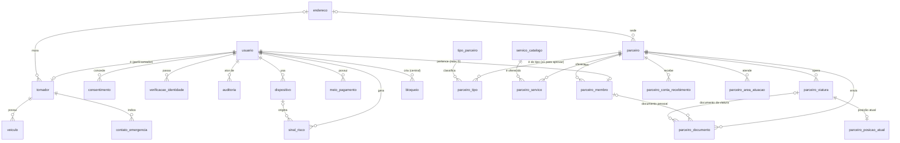

# Banco de dados do Safety Car

PostgreSQL 16 + PostGIS 3.6, migrações em SQL puro executadas com `psql`. A API (`apps/api`) conecta como `safetycar_app` e usa SQL puro parametrizado, sem ORM.

Este documento cobre a **base inicial**: identidade, tomador, parceiro tipificado, fundação geoespacial e antifraude base. O modelo de referência original é `docs/safety_car_modelo_dados_v1.sql`; as diferenças estão em [Decisões de modelagem](#decisões-de-modelagem).

## Sumário
1. [Como subir, migrar e testar](#como-subir-migrar-e-testar)
2. [Ambiente e papéis](#ambiente-e-papéis)
3. [Migrações](#migrações)
4. [Diagrama ER](#diagrama-er)
5. [Dicionário de dados](#dicionário-de-dados)
6. [Regras no banco (triggers e restrições)](#regras-no-banco-triggers-e-restrições)
7. [Geoespacial](#geoespacial)
8. [Dados sensíveis: cifragem e HMAC](#dados-sensíveis-cifragem-e-hmac)
9. [Decisões de modelagem](#decisões-de-modelagem)
10. [Fora desta fase e por quê](#fora-desta-fase-e-por-quê)
11. [Pendências (não decididas)](#pendências-não-decididas)

---

## Como subir, migrar e testar

Pré-requisitos: Docker Desktop rodando e Git Bash (no Windows). Nada é instalado no computador: o `psql` roda dentro do contêiner.

```bash
cp .env.example .env          # troque TODOS os valores (senhas fortes)
docker compose up -d          # sobe o banco; espere "healthy" em: docker compose ps
bash db/scripts/migrar.sh     # aplica as migrações pendentes no banco "safetycar"
bash db/scripts/testar.sh     # recria "safetycar_teste" do zero, migra duas vezes e roda db/tests
```

- `migrar.sh [banco]` aplica cada migração numa transação única e grava `versao`, `arquivo` e `sha256` em `schema_migracao`. Uma migração já aplicada é pulada. **Se o arquivo de uma migração aplicada mudar, o script para:** migração aplicada não se edita; cria-se outra.
- `testar.sh` não toca no banco de desenvolvimento. Cada arquivo de teste roda em `BEGIN … ROLLBACK`. Falha = `FALHOU: …`, e o script sai com código ≠ 0.
- Conexão a partir do computador: `127.0.0.1:${DB_PORTA}`, banco `safetycar`, usuário `safetycar_app` (ou `safetycar_migrator`) e a senha do `.env`. A porta só é publicada em 127.0.0.1.
- Recomeçar do zero apaga todos os dados locais: `docker compose down -v` e depois `docker compose up -d`. O script `db/init/01_papeis.sh` só roda quando o volume é novo.

Imagem fixada: `postgis/postgis:16-3.6`, digest `sha256:d07ce3f06f657b6516c7511412232e97174d7e9dcf4c9fe520109b682b44a201` (verificado em 2026-11-17).

## Ambiente e papéis

| Papel | Atributos | Uso |
|---|---|---|
| `postgres` | superusuário do contêiner | administração local; aplica **só** a `0001` (o PostGIS não é extensão *trusted*) |
| `safetycar_migrator` | LOGIN, sem superusuário, dono do banco e do schema `public` | aplica as migrações `0002` em diante |
| `safetycar_app` | LOGIN, NOSUPERUSER, NOCREATEDB, NOCREATEROLE, NOINHERIT | aplicação: DML, sem DDL (ver [0007](#migrações)) |

- As senhas vêm do `.env` (fora do Git). O `.env.example` só tem valores fictícios.
- Dentro do contêiner, conexões locais usam `trust` (padrão da imagem oficial). Pela rede (inclusive a partir do computador), a senha é exigida (`scram-sha-256`).
- `PUBLIC` não conecta em `safetycar` nem em `postgres`. O app recebe `CONNECT` e `TEMPORARY` na `0007`.

## Migrações

| Arquivo | Conteúdo |
|---|---|
| `0001_extensoes.sql` | `postgis`, `citext`, `pgcrypto` |
| `0002_nucleo.sql` | domínios de formato, `cnpj_dv`/`cnpj_valido`, `uf_codigo_ibge`, triggers genéricos (`definir_atualizado_em`, `exige_perfil`), `endereco`, `usuario`, `consentimento`, `verificacao_identidade`, `auditoria` |
| `0003_tomador.sql` | `tomador`, `veiculo`, `contato_emergencia` |
| `0004_parceiro.sql` | `tipo_parceiro` (com carga), `parceiro`, `parceiro_tipo`, `parceiro_membro`, `servico_catalogo` (com carga), `parceiro_servico`, `parceiro_viatura`, `parceiro_documento`, `parceiro_conta_recebimento` e as regras por tipo |
| `0005_geo.sql` | `endereco.localizacao`, `parceiro_area_atuacao`, `parceiro_posicao_atual`, `vw_parceiro_posicao_valida`, `parceiros_proximos()` |
| `0006_antifraude_base.sql` | `meio_pagamento`, `dispositivo`, `sinal_risco`, `bloqueio`, `esta_bloqueado()` |
| `0007_permissoes.sql` | privilégios do `safetycar_app` |

Privilégios do `safetycar_app` (0007):

| Objetos | Privilégio |
|---|---|
| `endereco`, `tomador`, `veiculo`, `contato_emergencia`, `parceiro`, `parceiro_tipo`, `parceiro_membro`, `parceiro_servico`, `parceiro_viatura`, `parceiro_documento`, `parceiro_conta_recebimento`, `parceiro_area_atuacao`, `parceiro_posicao_atual`, `meio_pagamento`, `dispositivo`, `bloqueio` | SELECT, INSERT, UPDATE, DELETE |
| `usuario`, `consentimento`, `verificacao_identidade` | SELECT, INSERT, UPDATE. Sem DELETE: a exclusão de usuário é lógica ou por anonimização; consentimento e verificação servem de prova perante a LGPD |
| `sinal_risco`, `auditoria` | SELECT, INSERT (registros de evento) |
| `tipo_parceiro`, `servico_catalogo`, `schema_migracao` | SELECT (mudam só por migração) |
| `vw_parceiro_posicao_valida` | SELECT |
| `parceiros_proximos`, `esta_bloqueado`, `cnpj_valido`, `cnpj_dv` | EXECUTE |

**Não há `ALTER DEFAULT PRIVILEGES`.** Toda migração futura que criar tabela, view ou função declara os GRANTs do app. É mais explícito e evita conceder DELETE sem querer.

## Diagrama ER



## Dicionário de dados

**Colunas comuns** (não repetidas abaixo):
- `id uuid`: chave primária, `gen_random_uuid()`. Não é dado pessoal por si só, mas identifica o titular quando cruzada com as demais tabelas.
- `criado_em timestamptz`: momento da criação, `now()`.
- `atualizado_em timestamptz`: mantida pelo trigger `definir_atualizado_em()` em todo UPDATE (o valor enviado é ignorado).

Coluna **Pessoal**: *sim* = dado pessoal (LGPD) ou pseudonimizado (hash) de pessoa natural; *PF/MEI* = pessoal quando o parceiro é pessoa física ou MEI; *não* = não é dado pessoal.

### Domínios

| Domínio | Base | Regra |
|---|---|---|
| `dom_cep` | text | `^[0-9]{8}$` |
| `dom_uf` | text | uma das 27 UFs |
| `dom_municipio_ibge` | integer | 7 dígitos (1000000 a 9999999) |
| `dom_e164` | text | `^\+[1-9][0-9]{7,14}$` |
| `dom_placa` | text | `^[A-Z]{3}[0-9][A-Z0-9][0-9]{2}$`: padrão antigo `ABC1234` e Mercosul `BRA2E19` |
| `dom_cnpj` | text | `cnpj_valido()`: `^[0-9A-Z]{12}[0-9]{2}$`, DV módulo 11 (caractere = ASCII − 48; vale para o CNPJ numérico e para o alfanumérico emitido desde jul/2026), rejeita os 14 caracteres iguais |
| `dom_hmac` | bytea | exatamente 32 bytes (HMAC-SHA256) |

### Núcleo (0002)

**endereco**: endereço postal, opcionalmente geocodificado.

| Coluna | Tipo | Finalidade | Pessoal |
|---|---|---|---|
| cep | dom_cep | CEP sem máscara | sim |
| logradouro, numero, complemento, bairro | text | endereço | sim |
| municipio | text | nome do município | sim |
| municipio_ibge | dom_municipio_ibge | código IBGE; CHECK: pertence à `uf` | sim |
| uf | dom_uf | UF | sim |
| localizacao | geography(Point,4326) | coordenada geocodificada (0005) | sim |

Índice: `ix_endereco_localizacao` (GiST), para buscar endereços (ex.: base do parceiro) perto de um ponto.

**usuario**: identidade. Senha, TOTP e códigos de recuperação ficam no Keycloak.

| Coluna | Tipo | Finalidade | Pessoal |
|---|---|---|---|
| keycloak_sub | uuid UNIQUE | vínculo com o usuário no Keycloak | sim |
| email | citext UNIQUE | login e contato; único sem diferenciar maiúsculas | sim |
| celular_e164 | dom_e164 UNIQUE | celular | sim |
| perfil | text CHECK | `tomador`, `parceiro`, `central` | não |
| status | text CHECK | `pendente`, `ativo`, `suspenso`, `bloqueado`, `excluido` | não |
| email_verificado_em, celular_verificado_em | timestamptz | quando foi verificado | sim |
| mfa_ativado_em | timestamptz | espelho do estado do 2FA no Keycloak | sim |
| ultimo_login_em | timestamptz | último acesso | sim |
| excluido_em | timestamptz | exclusão lógica; CHECK: preenchido se e só se `status = 'excluido'` | sim |

Unicidades: `keycloak_sub`, `email`, `celular_e164`. Trigger `tg_usuario_perfil_vinculado` (0004): o perfil não muda se o usuário já é tomador ou membro de parceiro.

**consentimento**: histórico de concessões e revogações (LGPD).

| Coluna | Tipo | Finalidade | Pessoal |
|---|---|---|---|
| usuario_id | uuid FK | titular | sim |
| finalidade | text CHECK | `termos_uso`, `politica_privacidade`, `compartilhar_localizacao`, `contato_comercial`, `compartilhar_parceiro_seguros` | não |
| versao_documento | text | versão do termo aceito | não |
| concedido_em, revogado_em | timestamptz | vigência; CHECK: revogação não é anterior à concessão | sim |
| ip, user_agent | inet, text | evidência do aceite | sim |

Índice: `ix_consentimento_usuario (usuario_id, finalidade)`, para "há consentimento vigente do usuário X para a finalidade Y?".

**verificacao_identidade**: e-mail, celular, CPF, documento com foto, selfie e CNH.

| Coluna | Tipo | Finalidade | Pessoal |
|---|---|---|---|
| usuario_id | uuid FK | titular | sim |
| tipo | text CHECK | `email`, `celular`, `cpf`, `documento_foto`, `selfie`, `cnh` | não |
| status | text CHECK | `pendente`, `aprovada`, `rejeitada`, `expirada` | não |
| provedor, referencia_externa | text | serviço de verificação e id no serviço | sim |
| motivo_rejeicao | text | justificativa | sim |
| solicitada_em, concluida_em, expira_em | timestamptz | ciclo da verificação | sim |

Índice: `ix_verificacao_usuario (usuario_id, tipo, status)`, para calcular o nível de verificação.

**auditoria**: somente inserção (privilégio na 0007 + trigger que bloqueia UPDATE, DELETE e TRUNCATE inclusive para o dono e o superusuário).

| Coluna | Tipo | Finalidade | Pessoal |
|---|---|---|---|
| ator_usuario_id | uuid FK | quem agiu (nulo = sistema) | sim |
| acao | text | o que foi feito | não |
| entidade, entidade_id | text, uuid | objeto afetado | não |
| antes, depois | jsonb | estado anterior e posterior | pode conter |
| ip | inet | origem | sim |

Índice: `ix_auditoria_entidade (entidade, entidade_id, criado_em)`, para o histórico de um objeto em ordem cronológica.

### Tomador (0003)

**tomador**: quem solicita o serviço. PK = `usuario_id` (perfil `tomador`, exigido por trigger).

| Coluna | Tipo | Finalidade | Pessoal |
|---|---|---|---|
| usuario_id | uuid PK/FK | usuário | sim |
| nome_completo, nome_social | text | nome | sim |
| cpf_cifrado | bytea | CPF cifrado pela aplicação | sim |
| cpf_hash | dom_hmac UNIQUE | busca e unicidade do CPF; CHECK: par com `cpf_cifrado` | sim |
| data_nascimento | date | idade | sim |
| endereco_id | uuid FK | endereço | sim |
| nivel_verificacao | smallint 1–3 | 1 = e-mail + 2FA; 2 = celular e CPF; 3 = documento com foto | sim |

**veiculo**

| Coluna | Tipo | Finalidade | Pessoal |
|---|---|---|---|
| tomador_id | uuid FK | dono | sim |
| placa | dom_placa | placa; UNIQUE por tomador (a mesma placa pode estar em tomadores diferentes) | sim |
| apelido, marca, modelo, cor | text | identificação | sim |
| ano_fabricacao, ano_modelo | smallint | ano | sim |
| categoria | text CHECK | `passeio`, `utilitario`, `moto`, `van`, `caminhao`, `onibus` | não |
| ativo | boolean | em uso | não |

Índice: a UNIQUE `(tomador_id, placa)` atende "veículos do tomador X".

**contato_emergencia**

| Coluna | Tipo | Finalidade | Pessoal |
|---|---|---|---|
| tomador_id | uuid FK | tomador | sim |
| nome | text | nome do contato | sim (de terceiro) |
| celular_e164 | dom_e164 | telefone do contato | sim (de terceiro) |
| parentesco | text | relação | sim |

Índice: `ix_contato_emergencia_tomador`, para "contatos do tomador X" durante um socorro.

### Parceiro (0004)

**tipo_parceiro**: catálogo (só leitura para o app).

| Coluna | Tipo | Finalidade | Pessoal |
|---|---|---|---|
| codigo | text PK | identificador (`^[a-z][a-z0-9_]*$`) | não |
| nome | text | rótulo | não |
| exige_viatura | boolean | só é aprovado com viatura ativa; CHECK: implica `permite_viatura` | não |
| permite_viatura | boolean | pode cadastrar viatura (e portanto ter posição) | não |
| exige_registro_susep | boolean | só é aprovado com `registro_susep` aprovado | não |
| assistencia_rodoviaria | boolean | presta socorro: serviços, área de atuação, busca por proximidade | não |
| ativo | boolean | tipo disponível para novos vínculos | não |

Carga inicial:

| codigo | exige_viatura | permite_viatura | exige_registro_susep | assistencia_rodoviaria |
|---|---|---|---|---|
| guincho | sim | sim | não | sim |
| mecanica | não | sim | não | sim |
| chaveiro | não | sim | não | sim |
| seguros | não | não | sim | não |

**parceiro**: empresa ou profissional (cobre o Prestador e o Parceiro de Seguros da v8).

| Coluna | Tipo | Finalidade | Pessoal |
|---|---|---|---|
| tipo_pessoa | text CHECK | `pj`, `mei`, `pf` | não |
| cnpj | dom_cnpj UNIQUE | obrigatório para `pj` e `mei` | PF/MEI |
| cpf_cifrado, cpf_hash | bytea, dom_hmac UNIQUE | obrigatório (`cpf_hash`) para `pf`; CHECK: par | sim |
| nome | text | razão social (PJ/MEI) ou nome completo (PF) | PF/MEI |
| nome_fantasia | text | nome comercial | não |
| email_comercial | citext | contato | PF/MEI |
| telefone_e164 | dom_e164 | contato | PF/MEI |
| endereco_id | uuid FK | sede | PF/MEI |
| status_credenciamento | text CHECK | `rascunho`, `em_analise`, `pendencia`, `aprovado`, `reprovado`, `suspenso`, `descredenciado` | não |
| motivo_status | text | justificativa | não |
| aprovado_em | timestamptz | data da aprovação | não |
| aprovado_por | uuid FK | usuário que aprovou (perfil `central`, exigido por trigger) | sim |

**parceiro_tipo** (N:N): `parceiro_id`, `tipo_codigo` (PK composta), `criado_em`. Não é dado pessoal. A PK atende "tipos do parceiro X".

**parceiro_membro**: usuários do parceiro. Um usuário pertence a, no máximo, um parceiro (`usuario_id` UNIQUE); o usuário precisa ter perfil `parceiro`.

| Coluna | Tipo | Finalidade | Pessoal |
|---|---|---|---|
| parceiro_id, usuario_id | uuid PK | vínculo | sim |
| papel | text CHECK | `proprietario`, `administrador`, `despachante`, `motorista_operador` | não |
| ativo, desde | boolean, timestamptz | vigência | não |

**servico_catalogo**: catálogo de serviços de socorro (só leitura para o app): `codigo` PK, `nome`, `exige_viatura`, `ativo`. Carga: `guincho_leve`, `guincho_pesado`, `mecanica_movel`, `chaveiro`, `bateria`, `pneu`, `combustivel`. Não é dado pessoal.

**parceiro_servico**: `parceiro_id`, `servico_codigo` (PK), `ativo`. Só para parceiro de tipo de assistência. A PK atende "o parceiro X oferece Y?", usada na busca por proximidade.

**parceiro_viatura**

| Coluna | Tipo | Finalidade | Pessoal |
|---|---|---|---|
| parceiro_id | uuid FK | dono | não |
| placa | dom_placa | UNIQUE por parceiro | PF/MEI |
| tipo | text CHECK | `guincho_plataforma`, `guincho_asa_delta`, `guincho_pesado`, `utilitario_mecanico`, `moto_socorro`, `outro` | não |
| marca_modelo, ano, capacidade_kg | text, smallint, integer | descrição; capacidade > 0 | não |
| ativa | boolean | em operação; só viatura ativa aparece na busca | não |

Índices: UNIQUE `(parceiro_id, placa)` atende "viaturas do parceiro X"; UNIQUE `(id, parceiro_id)` é o alvo da FK composta de `parceiro_documento`.

**parceiro_documento**

| Coluna | Tipo | Finalidade | Pessoal |
|---|---|---|---|
| parceiro_id | uuid FK | dono | não |
| usuario_id | uuid | documento pessoal de membro; FK composta `(parceiro_id, usuario_id)` → `parceiro_membro` | sim |
| viatura_id | uuid | documento da viatura; FK composta `(viatura_id, parceiro_id)` → `parceiro_viatura` | não |
| tipo | text CHECK | `contrato_social`, `cartao_cnpj`, `comprovante_endereco`, `cnh`, `crlv`, `seguro_rcf`, `rntrc`, `alvara`, `registro_susep` | não |
| arquivo_ref | text | chave no armazenamento de objetos (o arquivo não fica no banco) | sim |
| sha256 | char(64) | integridade do arquivo (hex minúsculo) | não |
| validade | date | vencimento | não |
| status | text CHECK | `enviado`, `aprovado`, `rejeitado`, `vencido` | não |
| motivo_rejeicao | text | justificativa | não |
| revisado_por, revisado_em | uuid FK, timestamptz | revisor (perfil `central`, exigido por trigger) | sim |
| enviado_em | timestamptz | envio | não |

Índices: `ix_parceiro_documento (parceiro_id, tipo, status)` para a análise e a regra de aprovação; `ix_parceiro_doc_validade (validade) WHERE status='aprovado'` para a rotina de vencimento.

**parceiro_conta_recebimento**: estrutura mínima para repasses futuros.

| Coluna | Tipo | Finalidade | Pessoal |
|---|---|---|---|
| parceiro_id | uuid FK | dono | não |
| tipo_chave_pix | text CHECK | `cpf`, `cnpj`, `email`, `celular`, `aleatoria` | não |
| chave_pix_cifrada | bytea | chave Pix cifrada pela aplicação | sim |
| verificada_em | timestamptz | validação da chave | não |
| ativa | boolean | conta em uso | não |

Índice: `ix_conta_recebimento_parceiro`.

### Geoespacial (0005)

**parceiro_area_atuacao**: só para parceiro de tipo de assistência.

| Coluna | Tipo | Finalidade | Pessoal |
|---|---|---|---|
| parceiro_id | uuid FK | dono | não |
| uf | dom_uf | UF atendida | não |
| municipio_ibge | dom_municipio_ibge | nulo = UF inteira; CHECK: pertence à `uf` | não |
| centro | geography(Point,4326) | centro do círculo de atendimento (opcional) | PF/MEI |
| raio_m | integer > 0 | raio em metros; CHECK: presente se e só se `centro` estiver | não |

Índices: UNIQUE NULLS NOT DISTINCT `(parceiro_id, uf, municipio_ibge)`; `ix_area_atuacao_centro` (GiST), para "quais parceiros atendem este ponto?".

**parceiro_posicao_atual**: uma linha por viatura, gravada por upsert; sem histórico.

| Coluna | Tipo | Finalidade | Pessoal |
|---|---|---|---|
| viatura_id | uuid PK/FK | viatura | não |
| localizacao | geography(Point,4326) | última posição | sim (localização do motorista) |
| precisao_m | numeric(8,1) ≥ 0 | precisão informada pelo GPS | não |
| velocidade_kmh | numeric(5,1) ≥ 0 | velocidade | sim |
| rumo_graus | numeric(4,1), 0 ≤ x < 360 | direção | não |
| atualizado_em | timestamptz | hora do servidor na gravação | sim |

Índice: `ix_posicao_atual_localizacao` (GiST), usado por `parceiros_proximos` (plano verificado com `EXPLAIN`).

### Antifraude (0006)

**meio_pagamento**: cartão tokenizado. **Não há coluna para número, CVV ou validade** (um teste confere isso).

| Coluna | Tipo | Finalidade | Pessoal |
|---|---|---|---|
| usuario_id | uuid FK | titular | sim |
| psp | text | processador (texto livre enquanto não for escolhido) | não |
| token_psp | text | token do cartão no PSP; UNIQUE `(psp, token_psp)` | sim |
| bandeira | text CHECK | `visa`, `mastercard`, `elo`, `amex`, `hipercard`, `outra` | não |
| final_4 | char(4) | últimos 4 dígitos | sim |
| cartao_fingerprint_hash | dom_hmac | fingerprint do cartão no PSP, em HMAC (detecta o mesmo cartão em várias contas) | sim |
| status | text CHECK | `ativo`, `inativo`, `bloqueado` | não |

Índices: `ix_meio_pagamento_usuario`; `ix_meio_pagamento_fingerprint` (parcial), para "mesmo cartão em várias contas?".

**dispositivo**

| Coluna | Tipo | Finalidade | Pessoal |
|---|---|---|---|
| usuario_id | uuid FK | usuário | sim |
| fingerprint_hash | dom_hmac | fingerprint do aparelho em HMAC; UNIQUE por usuário | sim |
| primeiro_visto_em, ultimo_visto_em | timestamptz | janela de uso; CHECK: último ≥ primeiro | sim |
| status | text CHECK | `ativo`, `suspeito`, `bloqueado` | não |

Índice: `ix_dispositivo_fingerprint`, para "mesmo aparelho em várias contas?".

**sinal_risco**: evento (o app só insere).

| Coluna | Tipo | Finalidade | Pessoal |
|---|---|---|---|
| usuario_id, dispositivo_id | uuid FK | alvo; CHECK: pelo menos um | sim |
| tipo | text CHECK | `multiplas_contas_dispositivo`, `dado_em_bloqueio`, `cartao_recusado`, `localizacao_inconsistente`, `cadastro_acelerado`, `outro` | não |
| severidade | text CHECK | `baixa`, `media`, `alta`, `critica` | não |
| detalhes | jsonb | contexto do sinal | pode conter |

Índice: `ix_sinal_risco_usuario (usuario_id, criado_em DESC)`, para "sinais recentes do usuário X".

**bloqueio**: lista de bloqueio por hash.

| Coluna | Tipo | Finalidade | Pessoal |
|---|---|---|---|
| tipo | text CHECK | `cpf_hash`, `dispositivo`, `celular`, `cartao_fingerprint`, `email` | não |
| valor_hash | dom_hmac | HMAC do valor bloqueado | sim |
| motivo | text | justificativa | pode conter |
| criado_por | uuid FK | usuário `central` (exigido por trigger) | sim |
| expira_em | timestamptz | nulo = permanente; CHECK: posterior a `criado_em`. Para encerrar, define-se `expira_em = now()` (o histórico fica) | não |

Índice: `ix_bloqueio_tipo_valor`, consultado a cada cadastro, login e pedido. Função `esta_bloqueado(tipo, hash)`.

### Controle

**schema_migracao**: criada pelo `migrar.sh`: `versao` PK, `arquivo`, `sha256`, `aplicada_em`. Não é dado pessoal.

## Regras no banco (triggers e restrições)

As regras ficam no banco para valer para qualquer cliente que venha a existir. Erros de regra usam SQLSTATE próprio (classe `SC`), para que a aplicação os trate sem interpretar texto:

| Código | Regra | Onde |
|---|---|---|
| SC001 | perfil incompatível: tomador precisa ter perfil `tomador`; membro de parceiro, `parceiro`; aprovador, revisor de documento e criador de bloqueio, `central`; usuário vinculado não troca de perfil | `exige_perfil()`, `usuario_perfil_vinculado()` |
| SC002 | viatura (inserção ou reativação) só para parceiro com tipo que **permite** viatura | `viatura_permitida()` |
| SC003 | aprovação de parceiro com tipo que exige Susep sem `parceiro_documento` `registro_susep` **aprovado** | `parceiro_aprovacao()` |
| SC004 | aprovação de parceiro com tipo que **exige** viatura sem viatura ativa | `parceiro_aprovacao()` |
| SC005 | `parceiro_servico` e `parceiro_area_atuacao` só para parceiro de tipo de assistência rodoviária | `exige_parceiro_assistencia()` |
| SC006 | remover ou trocar um tipo que deixaria viatura ativa sem tipo que a permita, ou serviços e áreas sem tipo de assistência | `parceiro_tipo_remocao()` |
| SC007 | aprovação de parceiro sem nenhum tipo | `parceiro_aprovacao()` |
| SC008 | vínculo com tipo de parceiro inativo | `parceiro_tipo_ativo()` |
| SC010 | UPDATE, DELETE ou TRUNCATE em `auditoria` | `auditoria_somente_insercao()` |
| 22023 | parâmetro inválido em `parceiros_proximos` (lat, lng, raio, serviço) | `parceiros_proximos()` |

Notas:
- A exigência de Susep e de viatura é verificada **no momento da aprovação** (transição para `aprovado`). Rascunho e análise ficam livres para o cadastro ir sendo completado. Um documento que vença ou seja rejeitado depois da aprovação **não** desaprova o parceiro automaticamente: isso é regra de negócio a definir (rotina de vencimento).
- O dono das tabelas (`safetycar_migrator`) pode remover triggers. A garantia contra alteração da auditoria vale para o app (privilégio + trigger) e para erro operacional, não para o dono agindo de propósito.

## Geoespacial

- Coordenadas sempre em `geography(Point, 4326)` (WGS 84). Na criação: `ST_SetSRID(ST_MakePoint(lng, lat), 4326)::geography`. **Atenção à ordem: longitude primeiro.**
- **Distâncias são geodésicas (linha reta sobre o elipsoide), não rota viária nem tempo de chegada.**
- **Área de atuação: centro + raio**, e não polígono. É como o parceiro declara a área ("atendo até 40 km da base"), é simples de cadastrar numa tela e `ST_DWithin(centro, ponto, raio_m)` usa o índice GiST diretamente. Polígono exigiria uma ferramenta de desenho e validação de geometria; se for necessário, entra depois como coluna nova. UF/município continuam valendo como recorte administrativo.
- **Posição atual**: uma linha por viatura, gravada com `INSERT … ON CONFLICT (viatura_id) DO UPDATE …`. `atualizado_em` é a hora do servidor. **Não há histórico** (pendência LGPD).
- **`vw_parceiro_posicao_valida`** (`security_invoker`): posições com `atualizado_em` de até **180 segundos**, de viaturas ativas, de parceiros `aprovado` com tipo de assistência rodoviária. Posição mais antiga não é apresentada como atual (regra herdada da v8).
- **`parceiros_proximos(lat, lng, raio_m, servico)`**: sobre a view acima, filtra quem oferece o serviço (ativo no parceiro e no catálogo), aplica `ST_DWithin` e ordena por `ST_Distance` (desempate: posição mais recente). Retorna **uma linha por viatura**: `parceiro_id`, `parceiro_nome`, `viatura_id`, `distancia_m`, `precisao_m`, `atualizado_em`. **Não** filtra pela área de atuação declarada (ver pendências).

## Dados sensíveis: cifragem e HMAC

- **CPF e chave Pix** são cifrados **na aplicação** antes de chegar ao banco (`bytea`). O banco nunca vê a chave de cifragem.
- **Busca e unicidade** usam HMAC-SHA256 (`dom_hmac`, 32 bytes) calculado pela aplicação com uma chave secreta **fora do repositório** (cofre ou variável de ambiente do backend, a definir com a stack).
- **Uma chave de HMAC e uma normalização para tudo**, para que os hashes sejam comparáveis entre tabelas (ex.: um `bloqueio` do tipo `cpf_hash` bate com `tomador.cpf_hash` e `parceiro.cpf_hash`):

  | Valor | Normalização antes do HMAC |
  |---|---|
  | CPF | só os 11 dígitos |
  | e-mail | minúsculas, sem espaços nas pontas |
  | celular | E.164 (`+5511…`) |
  | dispositivo | fingerprint do cliente, como recebido |
  | cartão | fingerprint fornecido pelo PSP |

- Trocar a chave de HMAC invalida todos os hashes: é preciso recalculá-los a partir dos valores cifrados (CPF) ou recebê-los de novo (dispositivo, cartão). Planejar antes de produção.
- **Cartão**: nunca número, CVV ou validade; só token do PSP, bandeira e final 4.
- **Senha, TOTP e códigos de recuperação** ficam no Keycloak. O banco guarda só `keycloak_sub` e o espelho `mfa_ativado_em`.
- `pgcrypto.hmac()` é usado **apenas nos testes**, com chave fictícia.

## Decisões de modelagem

Em relação ao `safety_car_modelo_dados_v1.sql`:

- **Perfil `seguradora` removido.** Seguros é um **tipo** de parceiro. A finalidade de consentimento `compartilhar_seguradora` virou `compartilhar_parceiro_seguros`.
- **Parceiro tipificado**: `tipo_parceiro` + `parceiro_tipo` (N:N). `razao_social` virou `nome` (razão social ou nome completo).
- **`exige_viatura` × `permite_viatura`** (decidido com o responsável): a posição é registrada por viatura, então mecânica e chaveiro precisam *poder* ter viatura para aparecer na busca, sem serem *obrigados* a ter. Só guincho exige.
- **Coluna `assistencia_rodoviaria`** no tipo: é o critério para "tipos de assistência" (serviços, área e busca).
- **Susep cobrado na aprovação** (decidido com o responsável).
- **CNPJ numérico e alfanumérico com DV** (decidido com o responsável).
- **Domínios** para formatos repetidos, em vez de copiar CHECKs.
- **uuid em todas as chaves**, inclusive `auditoria` (o v1 usava `bigserial`). A ordem vem de `criado_em`.
- **`atualizado_em` por trigger** em todas as tabelas mutáveis, inclusive as que não tinham a coluna no v1.
- **Coerência de perfil por trigger** e **FKs compostas** em `parceiro_documento`. São regras de integridade, não de negócio novas: o v1 já previa "um perfil por usuário" e "documento do parceiro".
- `usuario`: CHECK `status = 'excluido'` ⇔ `excluido_em` preenchido. `endereco` e área: município IBGE coerente com a UF.
- `sinal_risco.tipo`: lista inicial **proposta**, para revisão (`multiplas_contas_dispositivo`, `dado_em_bloqueio`, `cartao_recusado`, `localizacao_inconsistente`, `cadastro_acelerado`, `outro`).
- O app **não apaga** `usuario`, `consentimento`, `verificacao_identidade` nem `sinal_risco` (ver privilégios).

## Fora desta fase e por quê

| Item | Motivo |
|---|---|
| Chamados, chat, avaliações | próxima fase; tudo depende do chamado |
| Garantia/pré-autorização, taxas, evidências, disputa, repasse | dependem do chamado e de decisões pendentes (modelo de garantia, PSP, taxas) |
| Pagamentos e Pix no `meio_pagamento` | processador e modelo de garantia não decididos |
| Histórico de posições / rastreamento | prazo de retenção e base legal (LGPD) não decididos |
| Produtos e apólices de seguro | módulo de seguros pendente; só o parceiro do tipo `seguros` existe |
| Roteamento, ETA, Waze/Google Maps | motor de rotas não decidido; Waze e Maps são só navegação externa |
| Área de atuação por polígono | centro + raio atende o cadastro atual; ver [Geoespacial](#geoespacial) |

## Pendências (não decididas)

Registradas aqui; nenhuma foi decidida nesta fase.

1. **Retenção do histórico de GPS e base legal (LGPD).** Hoje só existe a posição atual.
2. **Motor de rotas/ETA**: serviço externo ou pgRouting com malha OSM.
3. ~~Stack de backend e frontend.~~ Decidida: ver `CLAUDE.md` (Stack).
4. **Valores de carência, taxas e níveis de verificação exigidos por serviço.**
5. Novos tipos de parceiro propostos, **não criados**: `borracharia`, `auto_eletrica`, `transporte_passageiro` (levar o motorista quando o veículo é guinchado).
6. `parceiros_proximos` deve também exigir que o ponto esteja na área de atuação declarada?
7. O que acontece com a aprovação quando um documento obrigatório (ex.: `registro_susep`) vence ou é rejeitado depois de aprovado?
8. Revisar a lista de `sinal_risco.tipo` e de `bandeira`.
9. Onde fica a chave de HMAC/cifragem e como é feita a rotação (depende da stack).
