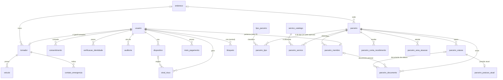
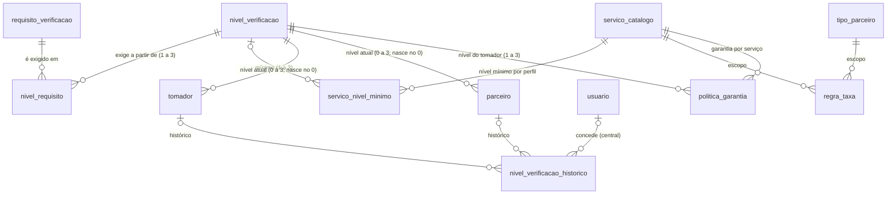
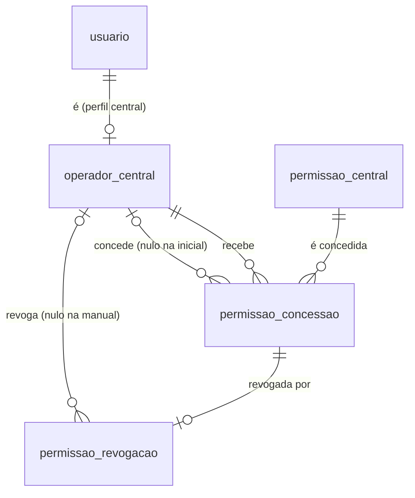
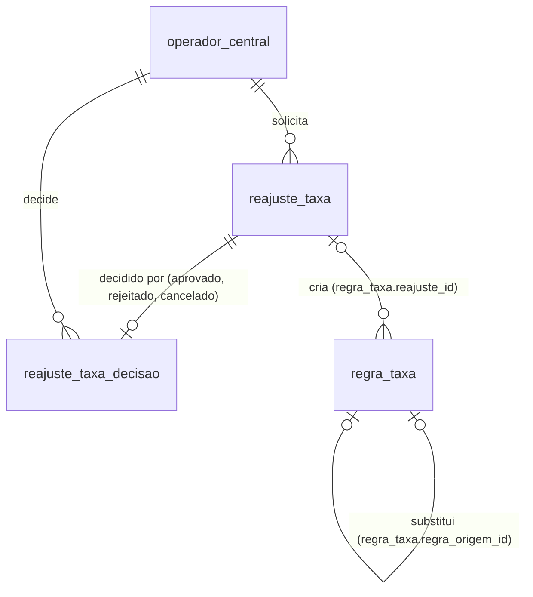

# Banco de dados do Safety Car

PostgreSQL 16 + PostGIS 3.6, migrações em SQL puro executadas com `psql`. A API (`apps/api`) conecta como `safetycar_app` e usa SQL puro parametrizado, sem ORM.

Este documento cobre a **base inicial** (identidade, tomador, parceiro tipificado, fundação geoespacial e antifraude base) e a **parametrização do modelo de negócio** (0008 a 0013: CPF obrigatório, níveis de verificação, taxas, garantia e provedores de pagamento, com valores a definir), além de **operadores e permissões da Central** (0014, ampliada na 0016) e do **reajuste de taxas em lote** com solicitação e aprovação (0015). O desenho aprovado em 23/11/2026 para permissões, tarifas e parâmetros está em `docs/CENTRAL_PERMISSOES_TARIFAS_PARAMETROS.md`; a conciliação com o que já existia está nas seções da 0016 em diante. O modelo de referência original é `docs/safety_car_modelo_dados_v1.sql`; as diferenças estão em [Decisões de modelagem](#decisões-de-modelagem).

## Sumário
1. [Como subir, migrar e testar](#como-subir-migrar-e-testar)
2. [Ambiente e papéis](#ambiente-e-papéis)
3. [Migrações](#migrações)
4. [Diagrama ER](#diagrama-er)
5. [Dicionário de dados](#dicionário-de-dados)
6. [Regras no banco (triggers e restrições)](#regras-no-banco-triggers-e-restrições)
7. [Geoespacial](#geoespacial)
8. [Dados sensíveis: cifragem e HMAC](#dados-sensíveis-cifragem-e-hmac)
9. [Decisões de modelagem](#decisões-de-modelagem)
10. [Fora desta fase e por quê](#fora-desta-fase-e-por-quê)
11. [Pendências (não decididas)](#pendências-não-decididas)

---

## Como subir, migrar e testar

Pré-requisitos: Docker Desktop rodando e Git Bash (no Windows). Nada é instalado no computador: o `psql` roda dentro do contêiner.

```bash
cp .env.example .env          # troque TODOS os valores (senhas fortes)
docker compose up -d          # sobe o banco; espere "healthy" em: docker compose ps
bash db/scripts/criar_papeis.sh  # só em volume antigo: cria safetycar_central (0014)
bash db/scripts/criar_papeis.sh --verificar    # login de cada papel com a senha do .env: ok ou FALHOU
bash db/scripts/criar_papeis.sh --sincronizar  # alinha com o .env a senha dos papéis que falharem
bash db/scripts/testar_senhas.sh  # à parte: testa os dois modos acima num contêiner descartável
bash db/scripts/migrar.sh     # aplica as migrações pendentes no banco "safetycar"
bash db/scripts/testar.sh     # recria "safetycar_teste" do zero, migra duas vezes e roda db/tests
bash db/scripts/testar_concorrencia.sh  # à parte: duas sessões simultâneas em "safetycar_conc" (0014 a 0016)
bash db/scripts/primeiro_administrador.sh --email … --sub … [--simular]  # uma vez por ambiente (ver 0014)
bash db/scripts/testar_primeiro_administrador.sh  # à parte: testa o script acima em bancos descartáveis
```

- `migrar.sh [banco]` aplica cada migração numa transação única e grava `versao`, `arquivo` e `sha256` em `schema_migracao`. Uma migração já aplicada é pulada. **Se o arquivo de uma migração aplicada mudar, o script para:** migração aplicada não se edita; cria-se outra.
- `testar.sh` não toca no banco de desenvolvimento. Cada arquivo de teste roda em `BEGIN … ROLLBACK`. Falha = `FALHOU: …`, e o script sai com código ≠ 0.
  - Sufixo do arquivo de teste: `_app.sql` roda como `safetycar_app`; `_central.sql` prepara dados como `postgres` até a linha `-- @como_central` e, dali em diante, roda como `safetycar_central` (`SET SESSION AUTHORIZATION`, então `session_user` é o papel da Central); os demais rodam como `safetycar_migrator`.
  - O `testar.sh` exige que o papel `safetycar_central` exista.
  - O `testar.sh` roda uma sessão por arquivo e **não cobre concorrência**. Isso fica no `testar_concorrencia.sh`, abaixo.
- `testar_concorrencia.sh`: fora da suíte padrão. Cria o banco descartável `safetycar_conc` e aplica as migrações do zero. Roda os cenários com **duas sessões `psql` simultâneas** e apaga o banco no fim, mesmo em caso de falha ou Ctrl+C. O `safetycar` não é tocado.
  - Em cada cenário, a sessão A faz a ação e segura a transação aberta (`pg_sleep`). O script dispara B e **confere no `pg_stat_activity` que B ficou bloqueada esperando lock**. Só então A faz o commit. Se B não esperar, o cenário falha, porque não houve concorrência.
  - A Central entra **por TCP com senha**: `-h db` dentro do contêiner, onde o `pg_hba.conf` exige `scram-sha-256`. A senha do `.env` vai por variável de ambiente, nunca pela linha de comando, e não é impressa. Uma pré-condição confere que senha errada é recusada.
  - Timeouts: `lock_timeout` de 15 s e `statement_timeout` de 30 s por sessão, 60 s por processo e 10 s por espera. O `deadlock_timeout` fica no padrão (1 s), para que um 40P01 apareça de fato.
  - Cada verificação imprime `OK` ou `FALHOU` com o SQLSTATE recebido. O script sai com código 1 se alguma falhar. Os cenários estão na [pendência 17](#pendências-não-decididas).
- `criar_papeis.sh`: cria, num volume **já existente**, os papéis que vieram depois do volume (hoje o `safetycar_central`). É idempotente: papel existente mantém a senha e só reafirma os atributos. Lê `SAFETYCAR_CENTRAL_PASSWORD` do `.env` sem executá-lo, nunca imprime a senha nem a passa na linha de comando (vai ao `psql` do contêiner por variável de ambiente e `\getenv`), e recusa o valor de exemplo (`trocar-*`) e senha com menos de 16 caracteres. Em volume novo, quem cria o papel é o `db/init/01_papeis.sh`, que exige a variável.
  - As senhas do `.env` só valem na **criação do volume**. Trocar uma senha no `.env` depois não muda o papel, e a API passa a falhar com `password authentication failed`. Os scripts não percebem, porque entram pelo socket do contêiner, que não pede senha.
  - Variáveis por papel: `safetycar_migrator` → `SAFETYCAR_MIGRATOR_PASSWORD`; `safetycar_app` → `SAFETYCAR_APP_PASSWORD`, e a API usa `API_DB_SENHA`, que **deve ser igual**; `safetycar_central` → `SAFETYCAR_CENTRAL_PASSWORD`.
  - `--verificar` (só leitura): conecta como cada papel por TCP dentro do contêiner. O host é o nome do contêiner, não o loopback, que no `pg_hba.conf` da imagem é `trust`. Imprime só `ok` ou `FALHOU` e avisa, sem mostrar valores, se `API_DB_SENHA`, `API_DB_USUARIO` ou `API_DB_PORTA` não baterem com as variáveis dos papéis.
  - `--sincronizar`: aplica as mesmas regras de senha aos três papéis e exige `API_DB_SENHA` igual a `SAFETYCAR_APP_PASSWORD`. Roda `ALTER ROLE … PASSWORD` (como `postgres`, pelo socket) **só nos papéis cujo login falhou**, depois de pedir o nome do banco como confirmação, e confere de novo no fim. Não cria papel. Rodar outra vez não altera nada.
  - Sigilo: a senha vai ao contêiner por `docker exec -e NOME` (sem o valor) e ao `psql` por `\getenv`, com o SQL na entrada padrão. Na sessão do `ALTER ROLE`, `log_statement` e `log_min_error_statement` são desligados, para que a senha não vá ao log do servidor nem em caso de erro. Resta só o texto do comando em `pg_stat_activity` durante a execução, visível ao superusuário.
  - `testar_senhas.sh`: os papéis valem para o servidor inteiro, então o teste sobe um **contêiner próprio** (mesma imagem, sem porta, dados em memória, `log_statement=all`), criado pelo `db/init` com senhas fictícias, e o remove no fim. Confere os dois modos, as recusas e que nenhuma senha gravada aparece na saída do script nem no `docker logs`.
- Conexão a partir do computador: `127.0.0.1:${DB_PORTA}`, banco `safetycar`, usuário `safetycar_app` (ou `safetycar_migrator`) e a senha do `.env`. A porta só é publicada em 127.0.0.1.
- Recomeçar do zero apaga todos os dados locais: `docker compose down -v` e depois `docker compose up -d`. O script `db/init/01_papeis.sh` só roda quando o volume é novo.

Imagem fixada: `postgis/postgis:16-3.6`, digest `sha256:d07ce3f06f657b6516c7511412232e97174d7e9dcf4c9fe520109b682b44a201` (verificado em 2026-11-17).

## Ambiente e papéis

| Papel | Atributos | Uso |
|---|---|---|
| `postgres` | superusuário do contêiner | administração local; aplica **só** a `0001` (o PostGIS não é extensão *trusted*) |
| `safetycar_migrator` | LOGIN, sem superusuário, dono do banco e do schema `public` | aplica as migrações `0002` em diante |
| `safetycar_app` | LOGIN, NOSUPERUSER, NOCREATEDB, NOCREATEROLE, NOINHERIT | aplicação: DML, sem DDL (ver [0007](#migrações)) |
| `safetycar_central` | LOGIN, NOSUPERUSER, NOCREATEDB, NOCREATEROLE, NOINHERIT, NOBYPASSRLS | **só o backend da Central, para ações sensíveis** (0014): lê o cadastro de operadores e permissões e age apenas pelas funções liberadas a ele; nenhuma escrita direta. Senha em `SAFETYCAR_CENTRAL_PASSWORD`, só no `.env` |

- As senhas vêm do `.env` (fora do Git). O `.env.example` só tem valores fictícios.
- Dentro do contêiner, conexões locais usam `trust` (padrão da imagem oficial). Pela rede (inclusive a partir do computador), a senha é exigida (`scram-sha-256`).
- `PUBLIC` não conecta em `safetycar` nem em `postgres`. O app recebe `CONNECT` e `TEMPORARY` na `0007`.

## Migrações

| Arquivo | Conteúdo |
|---|---|
| `0001_extensoes.sql` | `postgis`, `citext`, `pgcrypto` (o `btree_gist` entra na 0010) |
| `0002_nucleo.sql` | domínios de formato, `cnpj_dv`/`cnpj_valido`, `uf_codigo_ibge`, triggers genéricos (`definir_atualizado_em`, `exige_perfil`), `endereco`, `usuario`, `consentimento`, `verificacao_identidade`, `auditoria` |
| `0003_tomador.sql` | `tomador`, `veiculo`, `contato_emergencia` |
| `0004_parceiro.sql` | `tipo_parceiro` (com carga), `parceiro`, `parceiro_tipo`, `parceiro_membro`, `servico_catalogo` (com carga), `parceiro_servico`, `parceiro_viatura`, `parceiro_documento`, `parceiro_conta_recebimento` e as regras por tipo |
| `0005_geo.sql` | `endereco.localizacao`, `parceiro_area_atuacao`, `parceiro_posicao_atual`, `vw_parceiro_posicao_valida`, `parceiros_proximos()` |
| `0006_antifraude_base.sql` | `meio_pagamento`, `dispositivo`, `sinal_risco`, `bloqueio`, `esta_bloqueado()` |
| `0007_permissoes.sql` | privilégios do `safetycar_app` |
| `0008_cpf_obrigatorio.sql` | CPF do tomador `NOT NULL` (exigido no cadastro); responsável legal de PJ/MEI (`responsavel_nome`, `responsavel_cpf_cifrado`, `responsavel_cpf_hash`) exigido na aprovação (SC014) |
| `0009_niveis_verificacao.sql` | `auditoria.papel_bd`; auditoria automática da parametrização (`auditar_parametrizacao`, `bloquear_truncate`, `somente_insercao`); `nivel_verificacao`, `requisito_verificacao`, `nivel_requisito`, `servico_nivel_minimo`, `nivel_verificacao_historico`; `parceiro.nivel_verificacao`; `nivel_minimo_servico()`, `cumpre_nivel_minimo()` |
| `0010_regras_taxa.sql` | extensão `btree_gist`; `vigencia_imutavel()` (SC012); `regra_taxa` com exclusão de vigência por escopo; `regra_taxa_vigente()` |
| `0011_garantia_pagamento.sql` | `politica_garantia` (vigência imutável) e `politica_garantia_vigente()`; `provedor_pagamento` (capacidades, sem credenciais) |
| `0012_parametrizacao_carga.sql` | política "app só lê, alteração só por migração" (REVOKE e conferência); carga inicial toda `a_definir` (ver [Carga inicial](#carga-inicial-0012)) |
| `0013_nivel_zero.sql` | nível 0 "cadastro incompleto": catálogo de 0 a 3, cadastro nasce no 0, CHECK `>= 1` em requisito, nível mínimo e garantia, origem `migracao` no histórico, `cumpre_nivel_minimo` e `politica_garantia_vigente` redefinidas; rebaixa ao 0 quem estava no 1 sem histórico |
| `0014_operadores_permissoes.sql` | papel `safetycar_central` (conferido, não criado); `auditoria.papel_bd` = `session_user`; `permissao_central` (catálogo), `operador_central`, `permissao_concessao` e `permissao_revogacao` (somente inserção), `vw_permissao_vigente`; `operador_tem_permissao()`; funções da Central (`cadastrar_operador`, `definir_operador_ativo`, `conceder_permissao`, `revogar_permissao`) e manuais do migrator (`conceder_permissao_inicial`, `revogar_permissao_manual`) |
| `0015_reajuste_taxa.sql` | `reajuste_taxa` (lote) e `reajuste_taxa_decisao` (somente inserção), `vw_reajuste_taxa`; `regra_taxa.reajuste_id` e `regra_taxa.regra_origem_id`; `arredondar_centavos()`, `reajuste_calculo()`; funções da Central `simular_reajuste_taxa` (por parâmetros e por lote), `solicitar_reajuste_taxa`, `aprovar_reajuste_taxa`, `rejeitar_reajuste_taxa`, `cancelar_reajuste_taxa` |
| `0016_permissoes_central.sql` | `permissao_central.sensivel` e as permissões `solicitar_reajuste_taxa`, `analisar_cadastros` e `administrar_parametros`; regra do último titular de `conceder_permissao` (SC023) na revogação e na desativação; eventos `central_permissao_concedida`, `central_permissao_revogada` e `central_acesso`; `registrar_acesso_central()`; `vw_operador_permissao` e `vw_operador_central` |

Privilégios do `safetycar_app` (0007):

| Objetos | Privilégio |
|---|---|
| `endereco`, `tomador`, `veiculo`, `contato_emergencia`, `parceiro`, `parceiro_tipo`, `parceiro_membro`, `parceiro_servico`, `parceiro_viatura`, `parceiro_documento`, `parceiro_conta_recebimento`, `parceiro_area_atuacao`, `parceiro_posicao_atual`, `meio_pagamento`, `dispositivo`, `bloqueio` | SELECT, INSERT, UPDATE, DELETE |
| `usuario`, `consentimento`, `verificacao_identidade` | SELECT, INSERT, UPDATE. Sem DELETE: a exclusão de usuário é lógica ou por anonimização; consentimento e verificação servem de prova perante a LGPD |
| `sinal_risco`, `auditoria` | SELECT, INSERT (registros de evento) |
| `tipo_parceiro`, `servico_catalogo`, `schema_migracao` | SELECT (mudam só por migração) |
| `vw_parceiro_posicao_valida` | SELECT |
| `parceiros_proximos`, `esta_bloqueado`, `cnpj_valido`, `cnpj_dv` | EXECUTE |

Privilégios concedidos nas migrações seguintes (cada uma declara os seus):

| Objetos | Privilégio | Migração |
|---|---|---|
| `nivel_verificacao`, `requisito_verificacao`, `nivel_requisito`, `servico_nivel_minimo` | SELECT (parametrização) | 0009 |
| `nivel_verificacao_historico` | SELECT, INSERT (histórico; o trigger atualiza o nível atual) | 0009 |
| `nivel_minimo_servico`, `cumpre_nivel_minimo` | EXECUTE | 0009 |
| `regra_taxa` | SELECT (parametrização) | 0010 |
| `regra_taxa_vigente` | EXECUTE | 0010 |
| `politica_garantia`, `provedor_pagamento` | SELECT (parametrização) | 0011 |
| `politica_garantia_vigente` | EXECUTE | 0011 |
| `permissao_central` | SELECT (catálogo, sem dado de pessoa) | 0014 |
| `operador_tem_permissao` e demais funções da 0014 | **nenhum** (sem EXECUTE; ver [decisões](#decisões-de-modelagem)) | 0014 |
| `reajuste_taxa`, `reajuste_taxa_decisao`, `vw_reajuste_taxa` e todas as funções da 0015 | **nenhum**: os lotes identificam operadores; o app continua só lendo `regra_taxa`, inclusive as colunas novas | 0015 |
| `vw_operador_permissao`, `vw_operador_central` e todas as funções da 0016 | **nenhum**; o app continua lendo só `permissao_central` (agora com `sensivel`) | 0016 |

Privilégios do `safetycar_central` (0014):

| Objetos | Privilégio |
|---|---|
| banco | CONNECT, TEMPORARY; schema `public`: USAGE |
| `permissao_central`, `operador_central`, `permissao_concessao`, `permissao_revogacao`, `vw_permissao_vigente` | SELECT |
| `operador_tem_permissao`, `cadastrar_operador`, `definir_operador_ativo`, `conceder_permissao`, `revogar_permissao` | EXECUTE |
| `regra_taxa`, `reajuste_taxa`, `reajuste_taxa_decisao`, `vw_reajuste_taxa` (0015) | SELECT |
| `simular_reajuste_taxa` (as duas formas), `solicitar_reajuste_taxa`, `aprovar_reajuste_taxa`, `rejeitar_reajuste_taxa`, `cancelar_reajuste_taxa` (0015) | EXECUTE |
| `vw_operador_permissao`, `vw_operador_central` (0016) | SELECT |
| `registrar_acesso_central` (0016) | EXECUTE |
| demais tabelas (inclusive `usuario` e `auditoria`) | nenhum |

As funções da 0016 redefinidas por `CREATE OR REPLACE` (`definir_operador_ativo`, `conceder_permissao`, `revogar_permissao`) mantêm a assinatura e os GRANTs da 0014. As auxiliares `existe_outro_titular_conceder` e `exige_outro_titular_conceder` não têm GRANT para ninguém.

`conceder_permissao_inicial` e `revogar_permissao_manual` não têm GRANT: só o dono (`safetycar_migrator`) e o superusuário as executam. Todas as funções da 0014 e da 0015 que podem ser chamadas têm `REVOKE … FROM PUBLIC`. As auxiliares internas da 0015 (`arredondar_centavos`, `exige_operador_ativo`, `reajuste_validar`, `reajuste_calculo`, `reajuste_exigir_aplicavel`) não têm GRANT para ninguém: rodam dentro das funções da Central.

**Não há `ALTER DEFAULT PRIVILEGES`.** Toda migração futura que criar tabela, view ou função declara os GRANTs do app. É mais explícito e evita conceder DELETE sem querer.

## Diagrama ER



Parametrização (0009 em diante):



`provedor_pagamento` não tem relacionamento nesta fase (ver pendência 14).

Operadores e permissões da Central (0014):



Reajuste de taxas em lote (0015):



## Dicionário de dados

**Colunas comuns** (não repetidas abaixo):
- `id uuid`: chave primária, `gen_random_uuid()`. Não é dado pessoal por si só, mas identifica o titular quando cruzada com as demais tabelas.
- `criado_em timestamptz`: momento da criação, `now()`.
- `atualizado_em timestamptz`: mantida pelo trigger `definir_atualizado_em()` em todo UPDATE (o valor enviado é ignorado).

Coluna **Pessoal**: *sim* = dado pessoal (LGPD) ou pseudonimizado (hash) de pessoa natural; *PF/MEI* = pessoal quando o parceiro é pessoa física ou MEI; *não* = não é dado pessoal.

### Domínios

| Domínio | Base | Regra |
|---|---|---|
| `dom_cep` | text | `^[0-9]{8}$` |
| `dom_uf` | text | uma das 27 UFs |
| `dom_municipio_ibge` | integer | 7 dígitos (1000000 a 9999999) |
| `dom_e164` | text | `^\+[1-9][0-9]{7,14}$` |
| `dom_placa` | text | `^[A-Z]{3}[0-9][A-Z0-9][0-9]{2}$`: padrão antigo `ABC1234` e Mercosul `BRA2E19` |
| `dom_cnpj` | text | `cnpj_valido()`: `^[0-9A-Z]{12}[0-9]{2}$`, DV módulo 11 (caractere = ASCII − 48; vale para o CNPJ numérico e para o alfanumérico emitido desde jul/2026), rejeita os 14 caracteres iguais |
| `dom_hmac` | bytea | exatamente 32 bytes (HMAC-SHA256) |

### Núcleo (0002)

**endereco**: endereço postal, opcionalmente geocodificado.

| Coluna | Tipo | Finalidade | Pessoal |
|---|---|---|---|
| cep | dom_cep | CEP sem máscara | sim |
| logradouro, numero, complemento, bairro | text | endereço | sim |
| municipio | text | nome do município | sim |
| municipio_ibge | dom_municipio_ibge | código IBGE; CHECK: pertence à `uf` | sim |
| uf | dom_uf | UF | sim |
| localizacao | geography(Point,4326) | coordenada geocodificada (0005) | sim |

Índice: `ix_endereco_localizacao` (GiST), para buscar endereços (ex.: base do parceiro) perto de um ponto.

**usuario**: identidade. Senha, TOTP e códigos de recuperação ficam no Keycloak.

| Coluna | Tipo | Finalidade | Pessoal |
|---|---|---|---|
| keycloak_sub | uuid UNIQUE | vínculo com o usuário no Keycloak | sim |
| email | citext UNIQUE | login e contato; único sem diferenciar maiúsculas | sim |
| celular_e164 | dom_e164 UNIQUE | celular | sim |
| perfil | text CHECK | `tomador`, `parceiro`, `central` | não |
| status | text CHECK | `pendente`, `ativo`, `suspenso`, `bloqueado`, `excluido` | não |
| email_verificado_em, celular_verificado_em | timestamptz | quando foi verificado | sim |
| mfa_ativado_em | timestamptz | espelho do estado do 2FA no Keycloak | sim |
| ultimo_login_em | timestamptz | último acesso | sim |
| excluido_em | timestamptz | exclusão lógica; CHECK: preenchido se e só se `status = 'excluido'` | sim |

Unicidades: `keycloak_sub`, `email`, `celular_e164`. Trigger `tg_usuario_perfil_vinculado` (0004): o perfil não muda se o usuário já é tomador ou membro de parceiro.

**consentimento**: histórico de concessões e revogações (LGPD).

| Coluna | Tipo | Finalidade | Pessoal |
|---|---|---|---|
| usuario_id | uuid FK | titular | sim |
| finalidade | text CHECK | `termos_uso`, `politica_privacidade`, `compartilhar_localizacao`, `contato_comercial`, `compartilhar_parceiro_seguros` | não |
| versao_documento | text | versão do termo aceito | não |
| concedido_em, revogado_em | timestamptz | vigência; CHECK: revogação não é anterior à concessão | sim |
| ip, user_agent | inet, text | evidência do aceite | sim |

Índice: `ix_consentimento_usuario (usuario_id, finalidade)`, para "há consentimento vigente do usuário X para a finalidade Y?".

**verificacao_identidade**: e-mail, celular, CPF, documento com foto, selfie e CNH.

| Coluna | Tipo | Finalidade | Pessoal |
|---|---|---|---|
| usuario_id | uuid FK | titular | sim |
| tipo | text CHECK | `email`, `celular`, `cpf`, `documento_foto`, `selfie`, `cnh` | não |
| status | text CHECK | `pendente`, `aprovada`, `rejeitada`, `expirada` | não |
| provedor, referencia_externa | text | serviço de verificação e id no serviço | sim |
| motivo_rejeicao | text | justificativa | sim |
| solicitada_em, concluida_em, expira_em | timestamptz | ciclo da verificação | sim |

Índice: `ix_verificacao_usuario (usuario_id, tipo, status)`, para calcular o nível de verificação.

**auditoria**: somente inserção (privilégio na 0007 + trigger que bloqueia UPDATE, DELETE e TRUNCATE inclusive para o dono e o superusuário).

| Coluna | Tipo | Finalidade | Pessoal |
|---|---|---|---|
| ator_usuario_id | uuid FK | quem agiu (nulo = sistema) | sim |
| acao | text | o que foi feito | não |
| entidade, entidade_id | text, uuid | objeto afetado | não |
| antes, depois | jsonb | estado anterior e posterior | pode conter |
| ip | inet | origem | sim |

Índice: `ix_auditoria_entidade (entidade, entidade_id, criado_em)`, para o histórico de um objeto em ordem cronológica.

### Tomador (0003)

**tomador**: quem solicita o serviço. PK = `usuario_id` (perfil `tomador`, exigido por trigger).

| Coluna | Tipo | Finalidade | Pessoal |
|---|---|---|---|
| usuario_id | uuid PK/FK | usuário | sim |
| nome_completo, nome_social | text | nome | sim |
| cpf_cifrado | bytea NOT NULL | CPF cifrado pela aplicação; obrigatório no cadastro (0008) | sim |
| cpf_hash | dom_hmac NOT NULL UNIQUE | busca e unicidade do CPF; obrigatório no cadastro (0008) | sim |
| data_nascimento | date | idade | sim |
| endereco_id | uuid FK | endereço | sim |
| nivel_verificacao | smallint FK → `nivel_verificacao` | nível atual, de 0 a 3; **nasce no 0** (cadastro incompleto, 0013) e só muda por `nivel_verificacao_historico` (SC011). O CHECK de 1 a 3 da 0003 foi removido na 0013 (a FK limita os valores). **O comentário da 0003 ("1 = e-mail + 2FA; 2 = celular e CPF; 3 = documento com foto") está superado**: os requisitos estão em `nivel_requisito` | sim |

**veiculo**

| Coluna | Tipo | Finalidade | Pessoal |
|---|---|---|---|
| tomador_id | uuid FK | dono | sim |
| placa | dom_placa | placa; UNIQUE por tomador (a mesma placa pode estar em tomadores diferentes) | sim |
| apelido, marca, modelo, cor | text | identificação | sim |
| ano_fabricacao, ano_modelo | smallint | ano | sim |
| categoria | text CHECK | `passeio`, `utilitario`, `moto`, `van`, `caminhao`, `onibus` | não |
| ativo | boolean | em uso | não |

Índice: a UNIQUE `(tomador_id, placa)` atende "veículos do tomador X".

**contato_emergencia**

| Coluna | Tipo | Finalidade | Pessoal |
|---|---|---|---|
| tomador_id | uuid FK | tomador | sim |
| nome | text | nome do contato | sim (de terceiro) |
| celular_e164 | dom_e164 | telefone do contato | sim (de terceiro) |
| parentesco | text | relação | sim |

Índice: `ix_contato_emergencia_tomador`, para "contatos do tomador X" durante um socorro.

### Parceiro (0004)

**tipo_parceiro**: catálogo (só leitura para o app).

| Coluna | Tipo | Finalidade | Pessoal |
|---|---|---|---|
| codigo | text PK | identificador (`^[a-z][a-z0-9_]*$`) | não |
| nome | text | rótulo | não |
| exige_viatura | boolean | só é aprovado com viatura ativa; CHECK: implica `permite_viatura` | não |
| permite_viatura | boolean | pode cadastrar viatura (e portanto ter posição) | não |
| exige_registro_susep | boolean | só é aprovado com `registro_susep` aprovado | não |
| assistencia_rodoviaria | boolean | presta socorro: serviços, área de atuação, busca por proximidade | não |
| ativo | boolean | tipo disponível para novos vínculos | não |

Carga inicial:

| codigo | exige_viatura | permite_viatura | exige_registro_susep | assistencia_rodoviaria |
|---|---|---|---|---|
| guincho | sim | sim | não | sim |
| mecanica | não | sim | não | sim |
| chaveiro | não | sim | não | sim |
| seguros | não | não | sim | não |

**parceiro**: empresa ou profissional (cobre o Prestador e o Parceiro de Seguros da v8).

| Coluna | Tipo | Finalidade | Pessoal |
|---|---|---|---|
| tipo_pessoa | text CHECK | `pj`, `mei`, `pf` | não |
| cnpj | dom_cnpj UNIQUE | obrigatório para `pj` e `mei` | PF/MEI |
| cpf_cifrado, cpf_hash | bytea, dom_hmac UNIQUE | obrigatório (`cpf_hash`) para `pf`; CHECK: par | sim |
| responsavel_nome | text | nome do responsável legal (PJ/MEI); obrigatório quando há CPF do responsável (0008) | sim |
| responsavel_cpf_cifrado, responsavel_cpf_hash | bytea, dom_hmac | CPF do responsável legal, cifrado e com HMAC; **sem UNIQUE** (a mesma pessoa pode responder por várias empresas ou ser tomador). Exigido na aprovação de `pj`/`mei` (SC014); proibido para `pf` (o titular é o próprio `cpf_hash`). Índice parcial `ix_parceiro_responsavel_cpf` para antifraude (0008) | sim |
| nome | text | razão social (PJ/MEI) ou nome completo (PF) | PF/MEI |
| nome_fantasia | text | nome comercial | não |
| email_comercial | citext | contato | PF/MEI |
| telefone_e164 | dom_e164 | contato | PF/MEI |
| endereco_id | uuid FK | sede | PF/MEI |
| status_credenciamento | text CHECK | `rascunho`, `em_analise`, `pendencia`, `aprovado`, `reprovado`, `suspenso`, `descredenciado` | não |
| motivo_status | text | justificativa | não |
| aprovado_em | timestamptz | data da aprovação | não |
| aprovado_por | uuid FK | usuário que aprovou (perfil `central`, exigido por trigger) | sim |

**parceiro_tipo** (N:N): `parceiro_id`, `tipo_codigo` (PK composta), `criado_em`. Não é dado pessoal. A PK atende "tipos do parceiro X".

**parceiro_membro**: usuários do parceiro. Um usuário pertence a, no máximo, um parceiro (`usuario_id` UNIQUE); o usuário precisa ter perfil `parceiro`.

| Coluna | Tipo | Finalidade | Pessoal |
|---|---|---|---|
| parceiro_id, usuario_id | uuid PK | vínculo | sim |
| papel | text CHECK | `proprietario`, `administrador`, `despachante`, `motorista_operador` | não |
| ativo, desde | boolean, timestamptz | vigência | não |

**servico_catalogo**: catálogo de serviços de socorro (só leitura para o app): `codigo` PK, `nome`, `exige_viatura`, `ativo`. Carga: `guincho_leve`, `guincho_pesado`, `mecanica_movel`, `chaveiro`, `bateria`, `pneu`, `combustivel`. Não é dado pessoal.

**parceiro_servico**: `parceiro_id`, `servico_codigo` (PK), `ativo`. Só para parceiro de tipo de assistência. A PK atende "o parceiro X oferece Y?", usada na busca por proximidade.

**parceiro_viatura**

| Coluna | Tipo | Finalidade | Pessoal |
|---|---|---|---|
| parceiro_id | uuid FK | dono | não |
| placa | dom_placa | UNIQUE por parceiro | PF/MEI |
| tipo | text CHECK | `guincho_plataforma`, `guincho_asa_delta`, `guincho_pesado`, `utilitario_mecanico`, `moto_socorro`, `outro` | não |
| marca_modelo, ano, capacidade_kg | text, smallint, integer | descrição; capacidade > 0 | não |
| ativa | boolean | em operação; só viatura ativa aparece na busca | não |

Índices: UNIQUE `(parceiro_id, placa)` atende "viaturas do parceiro X"; UNIQUE `(id, parceiro_id)` é o alvo da FK composta de `parceiro_documento`.

**parceiro_documento**

| Coluna | Tipo | Finalidade | Pessoal |
|---|---|---|---|
| parceiro_id | uuid FK | dono | não |
| usuario_id | uuid | documento pessoal de membro; FK composta `(parceiro_id, usuario_id)` → `parceiro_membro` | sim |
| viatura_id | uuid | documento da viatura; FK composta `(viatura_id, parceiro_id)` → `parceiro_viatura` | não |
| tipo | text CHECK | `contrato_social`, `cartao_cnpj`, `comprovante_endereco`, `cnh`, `crlv`, `seguro_rcf`, `rntrc`, `alvara`, `registro_susep` | não |
| arquivo_ref | text | chave no armazenamento de objetos (o arquivo não fica no banco) | sim |
| sha256 | char(64) | integridade do arquivo (hex minúsculo) | não |
| validade | date | vencimento | não |
| status | text CHECK | `enviado`, `aprovado`, `rejeitado`, `vencido` | não |
| motivo_rejeicao | text | justificativa | não |
| revisado_por, revisado_em | uuid FK, timestamptz | revisor (perfil `central`, exigido por trigger) | sim |
| enviado_em | timestamptz | envio | não |

Índices: `ix_parceiro_documento (parceiro_id, tipo, status)` para a análise e a regra de aprovação; `ix_parceiro_doc_validade (validade) WHERE status='aprovado'` para a rotina de vencimento.

**parceiro_conta_recebimento**: estrutura mínima para repasses futuros.

| Coluna | Tipo | Finalidade | Pessoal |
|---|---|---|---|
| parceiro_id | uuid FK | dono | não |
| tipo_chave_pix | text CHECK | `cpf`, `cnpj`, `email`, `celular`, `aleatoria` | não |
| chave_pix_cifrada | bytea | chave Pix cifrada pela aplicação | sim |
| verificada_em | timestamptz | validação da chave | não |
| ativa | boolean | conta em uso | não |

Índice: `ix_conta_recebimento_parceiro`.

### Geoespacial (0005)

**parceiro_area_atuacao**: só para parceiro de tipo de assistência.

| Coluna | Tipo | Finalidade | Pessoal |
|---|---|---|---|
| parceiro_id | uuid FK | dono | não |
| uf | dom_uf | UF atendida | não |
| municipio_ibge | dom_municipio_ibge | nulo = UF inteira; CHECK: pertence à `uf` | não |
| centro | geography(Point,4326) | centro do círculo de atendimento (opcional) | PF/MEI |
| raio_m | integer > 0 | raio em metros; CHECK: presente se e só se `centro` estiver | não |

Índices: UNIQUE NULLS NOT DISTINCT `(parceiro_id, uf, municipio_ibge)`; `ix_area_atuacao_centro` (GiST), para "quais parceiros atendem este ponto?".

**parceiro_posicao_atual**: uma linha por viatura, gravada por upsert; sem histórico.

| Coluna | Tipo | Finalidade | Pessoal |
|---|---|---|---|
| viatura_id | uuid PK/FK | viatura | não |
| localizacao | geography(Point,4326) | última posição | sim (localização do motorista) |
| precisao_m | numeric(8,1) ≥ 0 | precisão informada pelo GPS | não |
| velocidade_kmh | numeric(5,1) ≥ 0 | velocidade | sim |
| rumo_graus | numeric(4,1), 0 ≤ x < 360 | direção | não |
| atualizado_em | timestamptz | hora do servidor na gravação | sim |

Índice: `ix_posicao_atual_localizacao` (GiST), usado por `parceiros_proximos` (plano verificado com `EXPLAIN`).

### Antifraude (0006)

**meio_pagamento**: cartão tokenizado. **Não há coluna para número, CVV ou validade** (um teste confere isso).

| Coluna | Tipo | Finalidade | Pessoal |
|---|---|---|---|
| usuario_id | uuid FK | titular | sim |
| psp | text | processador (texto livre enquanto não for escolhido) | não |
| token_psp | text | token do cartão no PSP; UNIQUE `(psp, token_psp)` | sim |
| bandeira | text CHECK | `visa`, `mastercard`, `elo`, `amex`, `hipercard`, `outra` | não |
| final_4 | char(4) | últimos 4 dígitos | sim |
| cartao_fingerprint_hash | dom_hmac | fingerprint do cartão no PSP, em HMAC (detecta o mesmo cartão em várias contas) | sim |
| status | text CHECK | `ativo`, `inativo`, `bloqueado` | não |

Índices: `ix_meio_pagamento_usuario`; `ix_meio_pagamento_fingerprint` (parcial), para "mesmo cartão em várias contas?".

**dispositivo**

| Coluna | Tipo | Finalidade | Pessoal |
|---|---|---|---|
| usuario_id | uuid FK | usuário | sim |
| fingerprint_hash | dom_hmac | fingerprint do aparelho em HMAC; UNIQUE por usuário | sim |
| primeiro_visto_em, ultimo_visto_em | timestamptz | janela de uso; CHECK: último ≥ primeiro | sim |
| status | text CHECK | `ativo`, `suspeito`, `bloqueado` | não |

Índice: `ix_dispositivo_fingerprint`, para "mesmo aparelho em várias contas?".

**sinal_risco**: evento (o app só insere).

| Coluna | Tipo | Finalidade | Pessoal |
|---|---|---|---|
| usuario_id, dispositivo_id | uuid FK | alvo; CHECK: pelo menos um | sim |
| tipo | text CHECK | `multiplas_contas_dispositivo`, `dado_em_bloqueio`, `cartao_recusado`, `localizacao_inconsistente`, `cadastro_acelerado`, `outro` | não |
| severidade | text CHECK | `baixa`, `media`, `alta`, `critica` | não |
| detalhes | jsonb | contexto do sinal | pode conter |

Índice: `ix_sinal_risco_usuario (usuario_id, criado_em DESC)`, para "sinais recentes do usuário X".

**bloqueio**: lista de bloqueio por hash.

| Coluna | Tipo | Finalidade | Pessoal |
|---|---|---|---|
| tipo | text CHECK | `cpf_hash`, `dispositivo`, `celular`, `cartao_fingerprint`, `email` | não |
| valor_hash | dom_hmac | HMAC do valor bloqueado | sim |
| motivo | text | justificativa | pode conter |
| criado_por | uuid FK | usuário `central` (exigido por trigger) | sim |
| expira_em | timestamptz | nulo = permanente; CHECK: posterior a `criado_em`. Para encerrar, define-se `expira_em = now()` (o histórico fica) | não |

Índice: `ix_bloqueio_tipo_valor`, consultado a cada cadastro, login e pedido. Função `esta_bloqueado(tipo, hash)`.

### Níveis de verificação (0009)

Parametrização: o app só lê; toda alteração é auditada (ver [Parametrização e auditoria](#parametrização-e-auditoria)). Nenhuma destas tabelas tem dado pessoal, exceto o histórico.

**nivel_verificacao**: `nivel` smallint PK (**0 a 3**, desde a 0013), `nome`, `descricao`. Carga: 0 "Cadastro incompleto" (0013; sem requisitos, não cumpre o mínimo de nenhum serviço, sem garantia) e 1, 2 e 3.

**requisito_verificacao**

| Coluna | Tipo | Finalidade |
|---|---|---|
| codigo | text PK | `email`, `celular`, `mfa`, `documento_foto`, `selfie`, `meio_pagamento_garantia`, `documentos_parceiro`, `conta_recebimento` |
| nome | text | rótulo |
| perfis | text[] | perfis a que pode ser exigido (`meio_pagamento_garantia` só tomador; `documentos_parceiro` e `conta_recebimento` só parceiro) |
| verificacao_tipo | text CHECK | tipo correspondente em `verificacao_identidade`, quando houver |

**nivel_requisito**: em que nível cada requisito passa a ser exigido, por perfil. PK `(perfil, requisito_codigo)`. O nível N exige todos os requisitos dos níveis 1..N do perfil. Colunas: `perfil`, `requisito_codigo`, `nivel` (CHECK `>= 1`: o nível 0 não tem requisitos, 0013), `situacao` (`a_definir`/`definido`), `observacao`. Trigger: requisito compatível com o perfil (SC015).

**servico_nivel_minimo**: PK `(servico_codigo, perfil)`; `nivel_minimo` (nulo se e só se `situacao = 'a_definir'`; CHECK `>= 1`, 0013: mínimo 0 liberaria o serviço para cadastro incompleto e só entra por migração nova e decisão explícita), `observacao`.
- `nivel_minimo_servico(servico, perfil)`: devolve o nível; **recusa com SC013** se estiver a definir ou não houver linha (22023 para serviço ou perfil inválido).
- `cumpre_nivel_minimo(perfil, nivel, servico)`: `nivel >= mínimo`. Nível nulo ou fora do catálogo: 22023 (0013). Mínimo a definir: **SC013, também para o nível 0** (a função nunca responde com parâmetro não decidido). Como todo mínimo definido é `>= 1`, **o nível 0 nunca cumpre**.

**parceiro.nivel_verificacao** (nova): smallint NOT NULL DEFAULT **0** (era 1 na 0009; 0013), FK → `nivel_verificacao`; mesma regra do tomador.

**nivel_verificacao_historico**: somente inserção (SC010); o app tem SELECT e INSERT.

| Coluna | Tipo | Finalidade | Pessoal |
|---|---|---|---|
| tomador_id / parceiro_id | uuid FK | alvo; CHECK: exatamente um | sim |
| nivel | smallint FK | nível concedido, de 0 a 3 (pode ser redução, inclusive ao 0) | sim |
| nivel_anterior | smallint | preenchido pelo trigger com o nível atual | sim |
| origem | text CHECK | `automatica` (cálculo da aplicação), `central` (manual), `carga_inicial` (importação da v8), `migracao` (ajuste feito por migração, 0013) | não |
| concedido_por | uuid FK | usuário `central` (exigido por trigger); obrigatório se `origem = 'central'` | sim |
| concedido_em | timestamptz | hora do servidor (`clock_timestamp()`, ignora o enviado) | sim |
| motivo | text | obrigatório se `origem = 'central'` | pode conter |

O AFTER INSERT atualiza o nível atual. `tomador`/`parceiro` **nascem no nível 0** (desde a 0013; antes, no 1) e um UPDATE do nível que não coincida com o registro mais recente é recusado (SC011). A promoção ao nível 1 só acontece por uma linha de histórico. O banco **não** confere se os requisitos foram cumpridos: o cálculo é da aplicação.

Na aplicação da 0013, quem estava no nível 1 **sem nenhuma linha de histórico** (só pelo padrão antigo) recebeu uma nova linha `origem = 'migracao'` para o nível 0. Quem tinha histórico manteve o nível. Nenhuma linha existente foi alterada.

### Regras de taxa (0010)

**regra_taxa**: um componente de preço por escopo, com vigência. Não é dado pessoal.

| Coluna | Tipo | Finalidade |
|---|---|---|
| tipo_parceiro_codigo | text FK NOT NULL | escopo: tipo de parceiro |
| servico_codigo | text FK NOT NULL | escopo: serviço |
| uf | dom_uf | escopo: UF; **nulo = nacional** (a regra da UF prevalece) |
| componente | text CHECK | `base`, `por_km`, `minimo`, `cancelamento`, `nao_comparecimento`, `comissao_plataforma` |
| unidade | text CHECK | fixa por componente (ver abaixo) |
| valor | bigint ≥ 0 | **inteiro**: centavos, centavos por km ou pontos-base (1 pb = 0,01%; máx. 10000). Nunca float |
| base_distancia | text CHECK | só no `por_km` (obrigatória nele): `linha_reta` (padrão, preenchido por trigger), `rodoviaria_snv`, `rodoviaria_osm`, `provedor_externo` |
| situacao | text CHECK | `a_definir` (valor obrigatoriamente 0) ou `definido` |
| observacao | text | nota livre |
| inicio_vigencia, fim_vigencia | timestamptz | vigência `[início, fim)`; fim nulo = em aberto; `fim = início` anula regra futura |
| reajuste_id | uuid FK | lote que criou esta regra (0015); nulo nas regras criadas por migração |
| regra_origem_id | uuid FK | regra que esta substituiu no reajuste (0015); CHECK: presente se e só se `reajuste_id` estiver |

Unidade por componente (CHECK `ck_regra_taxa_unidade`):

| Componente | Unidade |
|---|---|
| base, minimo, nao_comparecimento | `centavos` |
| por_km | `centavos_por_km` |
| cancelamento | `centavos` **ou** `pontos_base` |
| comissao_plataforma | `pontos_base` |

- **Sem sobreposição**: `ex_regra_taxa_vigencia` (EXCLUDE GiST, com `btree_gist`) por `(tipo, serviço, coalesce(uf,'*'), componente)` e `tstzrange(início, fim, '[)')`. Violação: 23P01. A restrição também serve de índice para a consulta.
- **Imutável** (`vigencia_imutavel()`, SC012): só `fim_vigencia` pode ser definido; sem início ou fim no passado; fim definido não é removido; regra encerrada não muda; sem DELETE. Mudar um valor = encerrar a vigente e inserir a próxima começando no fim dela.
- **`regra_taxa_vigente(tipo, servico, uf, componente, instante = now())`**: devolve a linha da UF ou, se não houver, a nacional. **Recusa com SC013** se não houver regra ou se a aplicável estiver `a_definir`, inclusive quando a da UF está a definir e há nacional definida (não cai na nacional). Parâmetro inválido: 22023. Não há função de cálculo do preço: o cálculo depende do chamado (fase seguinte).
- Fora desta fase: trechos de rodovia, motor de rotas, integração com Google/Waze. `base_distancia` só registra **qual** distância a regra usará.

### Garantia e provedores de pagamento (0011)

**politica_garantia**: quanto o tomador deixa de garantia, por serviço, nível de verificação do tomador e modalidade. Não é dado pessoal.

| Coluna | Tipo | Finalidade |
|---|---|---|
| servico_codigo | text FK | serviço |
| nivel_verificacao | smallint FK | nível do tomador; CHECK `>= 1` (o nível 0 não tem garantia, 0013) |
| modalidade | text CHECK | `pre_autorizacao_cartao`, `pix_pre_pago` |
| calculo | text CHECK | `valor_fixo` (usa `valor_centavos`) ou `percentual` (usa `percentual_bp`); CHECK: exatamente um dos dois |
| valor_centavos | bigint ≥ 0 | valor fixo em centavos |
| percentual_bp | integer 0–10000 | pontos-base **da estimativa do serviço** (o cálculo da estimativa é da fase do chamado) |
| situacao | text CHECK | `a_definir` (valor zerado) ou `definido` |
| inicio_vigencia, fim_vigencia | timestamptz | mesma regra da `regra_taxa` |

- `ex_garantia_vigencia`: sem sobreposição por `(serviço, nível, modalidade)` (23P01). Imutável por `vigencia_imutavel()` (SC012).
- `politica_garantia_vigente(servico, nivel, modalidade, instante = now())`: **recusa com SC013** se não houver política ou se estiver a definir (nunca devolve garantia zero); 22023 para parâmetro inválido **e para o nível 0** (não se aplica, 0013).

**provedor_pagamento**: catálogo de processadores e o que cada um suporta. **Sem chave, segredo, token, credencial nem URL de callback** (um teste confere os nomes das colunas): isso fica na configuração do backend, fora do Git.

| Coluna | Tipo | Finalidade |
|---|---|---|
| codigo | text | identificador (`^[a-z][a-z0-9_]*$`); UNIQUE `(codigo, ambiente)` |
| nome | text | rótulo |
| ambiente | text CHECK | `sandbox`, `producao` |
| suporta_pre_autorizacao, suporta_pix, suporta_split | boolean | capacidades |
| ativo | boolean | padrão **false**: ativação explícita |
| observacao | text | nota livre |

Fora desta fase: pagamento efetivo, pré-autorização real, repasse e integração com o provedor.

### Operadores e permissões da Central (0014)

**permissao_central**: catálogo de permissões de aprovador, uma por tipo de alteração sensível. É parametrização: só por migração, com auditoria. Não é dado pessoal.

| Coluna | Tipo | Finalidade |
|---|---|---|
| codigo | text PK | ver a tabela abaixo. Extensível por migração (ex.: `aprovar_bloqueio`, `aprovar_nivel_manual`) |
| nome, descricao | text | rótulo e explicação |
| ativo | boolean | permissão inativa não vale para ninguém e não é concedida |
| permite_autoaprovacao | boolean | exceção à regra "quem solicita não aprova o próprio pedido"; **desligada** em todas; CHECK: nunca ligada em `conceder_permissao` |
| sensivel | boolean (0016) | informativa para a API exigir OTP na sessão (o banco **não** valida 2FA); CHECK: sempre ligada em `conceder_permissao` |

Catálogo (conciliado com o desenho de 23/11/2026; os códigos da 0014 foram mantidos):

| codigo | Nome no desenho | Sensível | Situação |
|---|---|---|---|
| `conceder_permissao` | administrar_permissoes | sim | cadastra, ativa e desativa operadores; concede e revoga permissões (0014). Rótulo "Administrar permissões" desde a 0016 |
| `aprovar_reajuste_taxa` | aprovar_tarifa | sim | aprova e rejeita reajustes (0015) |
| `solicitar_reajuste_taxa` | solicitar_tarifa | não | criada na 0016; **só passa a ser exigida na 0019**. Até lá, qualquer operador ativo solicita (0015) |
| `analisar_cadastros` | igual | não | criada na 0016; **ainda não imposta pelo banco** (ver [pendências](#pendências-não-decididas)) |
| `administrar_parametros` | igual | sim | criada na 0016; usada pelos parâmetros (0018) |

**operador_central**: quem opera a Central.

| Coluna | Tipo | Finalidade | Pessoal |
|---|---|---|---|
| usuario_id | uuid PK/FK | usuário de perfil `central` (exigido por trigger) | sim |
| ativo | boolean | inativo perde todas as permissões, sem tocar no histórico | sim |

Não é excluído (só desativado, SC010). O usuário que é operador não troca de perfil (SC001). Muda só pelas funções `cadastrar_operador` e `definir_operador_ativo`, com auditoria e motivo.

**permissao_concessao** (somente inserção, SC010):

| Coluna | Tipo | Finalidade | Pessoal |
|---|---|---|---|
| operador_id | uuid FK | quem recebeu | sim |
| permissao_codigo | text FK | permissão | não |
| concedida_por | uuid FK | quem concedeu; nulo só se `origem = 'inicial'` | sim |
| concedida_em | timestamptz | hora do servidor (`clock_timestamp()`, ignora o enviado) | sim |
| motivo | text | obrigatório | pode conter |
| origem | text CHECK | `operador` ou `inicial` (só de `conceder_permissao`) | não |
| papel_bd | text | `session_user` de quem gravou | não |

**permissao_revogacao** (somente inserção, SC010): `concessao_id` UNIQUE FK, `revogada_por` (nulo só se `origem = 'manual'`), `revogada_em` (hora do servidor), `motivo` (obrigatório), `origem` (`operador` ou `manual`), `papel_bd`.

**Permissão vigente** = concessão sem revogação; não há campo editável. A permissão é **efetiva** quando o operador está ativo, o usuário está `ativo` com perfil `central` e a permissão está ativa no catálogo.
- `operador_tem_permissao(usuario, permissao) → boolean`: SECURITY DEFINER, só leitura, devolve apenas o boolean; 22023 para permissão inexistente. EXECUTE só para o migrator e para o `safetycar_central`.
- `vw_permissao_vigente` (`security_invoker`): concessões sem revogação, com a coluna `efetiva`.

**Regras** (nos triggers, valem para qualquer escritor, inclusive o migrator):
- conceder a si mesmo: SC017;
- quem concede precisa ter `conceder_permissao` efetiva: SC016;
- quem recebe precisa ser operador ativo: SC016;
- permissão inativa: 22023;
- concessão repetida enquanto vigente: SC018;
- concessão inicial: só de `conceder_permissao` (23514) e só quando **não existe nenhuma** concessão de `conceder_permissao` sem revogação (SC018);
- revogar a própria permissão é permitido, porque só reduz poder; revogar a de outro exige `conceder_permissao` (SC016); revogar o que não está vigente: SC018.
- **último titular** (0016): revogar (origem `operador`) ou desativar o último operador com `conceder_permissao` **efetiva** é recusado (SC023), inclusive por INSERT ou UPDATE direto. Um titular que já não é efetivo (operador inativo ou usuário não ativo) não conta como "outro titular", e removê-lo não é barrado. A **revogação manual** do migrator continua liberada: é o caminho de recuperação. A regra vale só para `conceder_permissao`; o último aprovador de reajuste, por exemplo, pode abdicar.

**Locks**: a concessão trava a linha do operador (`FOR UPDATE`) e a linha do catálogo, já no modo final: `FOR UPDATE` na inicial e `FOR SHARE` nas demais. Nunca `FOR SHARE` seguido de `FOR UPDATE` na mesma linha, para que duas iniciais simultâneas terminem em SC018, e não em deadlock (40P01). A revogação trava a concessão, e a `UNIQUE (concessao_id)` é a última barreira.
- Desde a 0016, `revogar_permissao` (de `conceder_permissao`) e `definir_operador_ativo` (ao desativar) travam **antes** a linha `conceder_permissao` do catálogo (`FOR UPDATE`), na mesma ordem da concessão (catálogo e depois operador). Duas remoções simultâneas dos dois últimos titulares ficam em série, e a segunda termina em SC023 (cenários 7a e 7b do `testar_concorrencia.sh`). Um INSERT ou UPDATE direto, fora das funções, trava na ordem inversa: numa corrida pode dar 40P01, mas nunca deixa a Central sem titular.

**Eventos de auditoria com nome próprio** (0016), gravados pelas funções na mesma transação, além da linha automática `parametrizacao_insert`. Só identificadores internos, vigência antes e depois e o motivo:
- `central_permissao_concedida` (`entidade = permissao_concessao`);
- `central_permissao_revogada` (`entidade = permissao_revogacao`);
- `central_acesso` (`entidade = operador_central`), por `registrar_acesso_central(ator)`, que a API chama uma vez por início de sessão. Exige operador ativo (SC016).

Se a gravação na auditoria falhar, a operação inteira é desfeita (há teste). A concessão inicial e a revogação manual continuam só com a auditoria automática (papel `safetycar_migrator`, sem ator).

**Visões da Central** (0016): `vw_operador_permissao` (`security_invoker`) traz o histórico de concessões com a revogação, `vigente`, `efetiva` e `sensivel`. `vw_operador_central` traz operador, `ativo` e `ultimo_acesso_em`. Esta segunda visão **não** é `security_invoker`, de propósito: a Central não lê a auditoria, e a visão expõe só o instante do último `central_acesso`.

**Funções da Central** (SECURITY DEFINER, `SET search_path = public, pg_temp`, EXECUTE só para o `safetycar_central`): `cadastrar_operador(ator, usuario, motivo)`, `definir_operador_ativo(ator, operador, ativo, motivo)`, `conceder_permissao(ator, operador, permissao, motivo)`, `revogar_permissao(ator, operador, permissao, motivo)`.
- Ninguém cadastra, ativa ou desativa a si mesmo (SC017).
- Motivo obrigatório (22023).
- O ator é gravado com `set_config('safetycar.ator_usuario_id', …, is_local = true)` (equivale a `SET LOCAL`), e o **valor anterior é restaurado no fim**: uma chamada aninhada não apaga o ator de quem a chamou.

**Funções manuais do migrator** (sem GRANT; chamadas à mão, via `psql`):
- `conceder_permissao_inicial(usuario, motivo)`: cadastra o operador, se preciso, e concede `conceder_permissao` com `origem = 'inicial'`. Fica na auditoria com `papel_bd = safetycar_migrator` e sem ator.
- `revogar_permissao_manual(operador, permissao, motivo)`: revogação de emergência, com `origem = 'manual'`.

**Primeiro administrador** (`db/scripts/primeiro_administrador.sh`): define, num ambiente, quem detém a primeira `conceder_permissao`. O script é explícito, auditado e não grava dado pessoal no repositório (os valores vêm por argumento).

```bash
# valores fictícios; use o e-mail e o ID do usuário no Keycloak DESTE ambiente
bash db/scripts/primeiro_administrador.sh --email admin@exemplo.invalid \
     --sub 00000000-0000-4000-8000-0000000000a1 --simular          # mostra e desfaz
bash db/scripts/primeiro_administrador.sh --email admin@exemplo.invalid \
     --sub 00000000-0000-4000-8000-0000000000a1 [--banco safetycar] [--motivo "…"]
```

- **Argumentos:**
  - `--sub` é o **ID** do usuário no Keycloak (painel → *Users* → usuário → *Details*), que vira `usuario.keycloak_sub`;
  - `--banco` tem padrão `safetycar` e recusa `postgres`, `template0` e `template1`;
  - `--motivo` tem um padrão fixo ("Primeiro administrador de permissões (db/scripts/primeiro_administrador.sh)").
- **Validações, antes de gravar:**
  - formato do e-mail e do uuid (normalizado para minúsculas);
  - banco existente e com a 0014 aplicada;
  - usuário com esse `sub` e outro perfil: aborta (o perfil não muda);
  - usuário com esse `sub`, perfil central e e-mail ou status diferente de `ativo`: aborta;
  - e-mail já usado por outro `sub`: aborta.
  Nenhuma recusa altera nada.
- **Confirmação:** o script mostra banco, e-mail, `sub` e motivo, e só grava se você **digitar o nome do banco alvo**. Qualquer outra resposta, inclusive vazia, encerra sem gravar (código de saída 2). `--simular` não pede confirmação: roda a transação e termina com `ROLLBACK`.
- **Gravação**, numa única transação, como `safetycar_migrator` (pelo socket local do contêiner, sem ler senha nenhuma):
  1. cria o `usuario` com perfil `central`, status `ativo` e `email_verificado_em` nulo, se ainda não existir. Quem verifica o e-mail é o Keycloak, e nenhuma regra do banco usa essa coluna;
  2. grava em `auditoria` a criação (`acao = 'migrator_criar_usuario_central'`, com perfil, status e motivo, **sem o e-mail**);
  3. chama `conceder_permissao_inicial`, que cadastra o operador e concede `conceder_permissao` com origem `inicial`. Os triggers auditam o operador e a concessão.

  Toda essa auditoria fica com `papel_bd = safetycar_migrator` e sem ator. Um usuário já existente só é reaproveitado se tiver o mesmo `sub`, perfil central, o mesmo e-mail e status `ativo`.
- **Já há detentor vigente** de `conceder_permissao`: a concessão inicial é recusada (SC018). O script mostra o id do detentor e o caminho de recuperação acima (`revogar_permissao_manual` e depois rodar o script de novo), **mas não o executa**.
- **Um ambiente, um `sub`:** cada ambiente (por exemplo, trabalho e casa) tem o seu próprio Keycloak e, portanto, o seu próprio usuário e o seu próprio `keycloak_sub`, mesmo com o mesmo e-mail. O script roda **uma vez em cada ambiente**, com o `sub` daquele Keycloak. Nenhum `sub` ou e-mail real vai para o Git.
- **Teste:** `bash db/scripts/testar_primeiro_administrador.sh`, fora da suíte padrão. Ele cria os bancos descartáveis `safetycar_adm` (migrado do zero) e `safetycar_adm_vazio` (sem a 0014) e os apaga no fim, mesmo com falha. Usa só dados fictícios. Cenários:
  - argumentos e bancos inválidos;
  - banco inexistente e banco sem a 0014;
  - simulação sem nenhuma linha nova, nem de auditoria (o schema não tem sequências);
  - resposta vazia, `CONFIRMO` ou nome de outro banco: nada gravado;
  - gravação com a auditoria conferida (`papel_bd` e motivo, sem o e-mail);
  - segunda execução recusada com SC018;
  - outro perfil, e-mail de outro `sub`, e-mail divergente e status não ativo: abortam;
  - reaproveitamento de um usuário central ativo.

### Reajuste de taxas em lote (0015)

Qualquer operador ativo da Central **solicita e simula**; quem tem a permissão `aprovar_reajuste_taxa` efetiva **aprova ou rejeita**. Nada entra em vigor sem aprovação.

**reajuste_taxa**: o lote solicitado (somente inserção, SC010).

| Coluna | Tipo | Finalidade | Pessoal |
|---|---|---|---|
| tipo | text CHECK | `percentual` ou `valor` | não |
| percentual_bp | integer | só no `percentual`: de **−5000 a +5000 pb**, diferente de 0 | não |
| valor_centavos | bigint | só no `valor`: diferente de 0 (positivo ou negativo); **só componentes em centavos** (nunca `por_km` nem pontos-base) | não |
| tipos_parceiro, servicos | text[] | escopo; nulo = todos; cada código precisa existir | não |
| ufs | text[] | nulo = todas as regras **estaduais**; senão, só as regras daquelas UFs | não |
| inclui_nacional | boolean | a regra **nacional** (`uf` nula) só entra com `true`; ela vale para todas as UFs sem regra própria | não |
| componentes | text[] | não vazio; dentro dos 6 componentes | não |
| inclui_pontos_base | boolean | regras em pontos-base (comissão e cancelamento percentual) só entram com `true`; a comissão só pode ser listada com `true` | não |
| motivo | text | obrigatório | pode conter |
| indice_referencia | text | opcional, texto livre (ex.: "IPCA out/2026"); não há busca automática | não |
| inicio_solicitado | timestamptz | nulo = no momento da aprovação | não |
| solicitado_por, solicitado_em, papel_bd | uuid FK, timestamptz, text | operador ativo; hora do servidor; `session_user` | sim |

**reajuste_taxa_decisao** (somente inserção, uma por lote: UNIQUE `reajuste_id`): `situacao` (`aprovado`, `rejeitado` ou `cancelado`), `decidido_por`, `decidido_em` (hora do servidor), `motivo` (obrigatório), `papel_bd`; só na aprovação: `inicio_efetivo`, `regras_afetadas` e `autoaprovacao`.

**vw_reajuste_taxa** (`security_invoker`): o lote mais a decisão, com `situacao` derivada (`solicitado` enquanto não houver decisão).

**Escopo de um lote**: regras vigentes no instante da aprovação, de tipo e serviço do escopo, cuja UF está em `ufs` (ou que são nacionais, com `inclui_nacional`), de um componente listado, e em pontos-base só com `inclui_pontos_base`. Um reajuste de "SP" só altera as regras **da UF SP**; não cria regra de SP a partir da nacional. Regras anuladas (intervalo vazio) não entram.

**Funções da Central** (SECURITY DEFINER, EXECUTE só para o `safetycar_central`; ator verificado, auditado e restaurado ao fim):

| Função | Quem | O que faz |
|---|---|---|
| `simular_reajuste_taxa(ator, …parâmetros, inicio)` e `simular_reajuste_taxa(ator, reajuste_id)` | operador ativo | só leitura: uma linha por regra do escopo com valor atual, valor novo, `abrangencia` (a nacional aparece como "nacional: vale para todas as UFs sem regra própria") e `problema` (`a_definir`, `regra_futura`, `termina_antes_do_inicio`, `negativo`, `zeraria`, `acima_10000_pb`, `sem_alteracao`) |
| `solicitar_reajuste_taxa(ator, …, motivo, indice, inicio)` | operador ativo | grava o lote **sem tocar em nenhuma regra**; já recusa o que a aprovação recusaria |
| `aprovar_reajuste_taxa(ator, reajuste_id, motivo, inicio)` | `aprovar_reajuste_taxa`, e não o solicitante | ver abaixo; devolve quantas regras ganharam nova versão |
| `rejeitar_reajuste_taxa(ator, reajuste_id, motivo)` | `aprovar_reajuste_taxa` | só grava a decisão |
| `cancelar_reajuste_taxa(ator, reajuste_id, motivo)` | o próprio solicitante (ativo) ou quem tem `aprovar_reajuste_taxa` | só grava a decisão |

**Aprovação**, numa só transação. Todas as checagens vêm antes de qualquer escrita, então não há reajuste parcial:
1. `pg_advisory_xact_lock(150001)` serializa as aprovações de reajuste de taxa. Depois, `FOR UPDATE` no lote (já decidido: SC020).
2. Se quem aprova é quem solicitou e `permite_autoaprovacao` está desligada: SC017.
3. `FOR UPDATE` nas regras do escopo, em ordem de id. Só **depois dos locks** o relógio é lido (`clock_timestamp()`). O início padrão e a checagem de "início no passado" (SC012) usam esse mesmo relógio, nunca `now()`.
4. Checagens:
   - escopo vazio: SC019;
   - regra `a_definir`: SC013;
   - regra futura agendada no escopo, ou vigente que termina em ou antes do início: SC021;
   - resultado negativo, zerado a partir de um valor maior que zero, ou acima de 10000 pb: SC022;
   - **nenhuma regra muda de valor: SC022 ("nada a alterar")**.
5. Para cada regra: `fim_vigencia = início` na antiga e uma nova linha `definido` com `inicio_vigencia = início`, o mesmo escopo, a mesma unidade e `base_distancia`, `fim_vigencia` igual ao fim da antiga, `reajuste_id` e `regra_origem_id`. Antiga e nova ficam contíguas, sem sobreposição. **Uma regra cujo valor fica igual também ganha a nova versão.**
6. Grava a decisão com `inicio_efetivo`, `regras_afetadas` e `autoaprovacao`.

**Arredondamento**: `arredondar_centavos(x) = floor(x + 0,5)`, só com `numeric`. Fração de 0,5 ou mais sobe; menor que 0,5 desce. Exemplos: 1,5 → 2; 1,49 → 1; 2,5 → 3; 0,5 → 1. No percentual, `valor_novo = arredondar_centavos(valor × (10000 + pb) / 10000)`, **uma única vez, sobre o valor final**, sem arredondar o fator nem passos intermediários. Como o valor de partida é sempre inteiro em centavos, arredondar o valor final ou a diferença dá o mesmo resultado; a garantia de "uma vez só" está na forma do código, e não num teste que distinga os dois.

**Direito adquirido**: o reajuste nunca apaga nem altera a regra antiga além do fim da vigência. Ela continua consultável **por data**, com `regra_taxa_vigente(…, instante)` (antes do início devolve a antiga; a partir dele, a nova), e **por id**. Quando o chamado existir (fase seguinte), ele guardará o `regra_taxa.id` de cada componente e os valores usados na hora do pedido; um chamado em andamento mantém o preço da hora do pedido.

### Controle

**schema_migracao**: criada pelo `migrar.sh`: `versao` PK, `arquivo`, `sha256`, `aplicada_em`. Não é dado pessoal.

## Regras no banco (triggers e restrições)

As regras ficam no banco para valer para qualquer cliente que venha a existir. Erros de regra usam SQLSTATE próprio (classe `SC`), para que a aplicação os trate sem interpretar texto:

| Código | Regra | Onde |
|---|---|---|
| SC001 | perfil incompatível: tomador precisa ter perfil `tomador`; membro de parceiro, `parceiro`; aprovador, revisor de documento e criador de bloqueio, `central`; usuário vinculado não troca de perfil | `exige_perfil()`, `usuario_perfil_vinculado()` |
| SC002 | viatura (inserção ou reativação) só para parceiro com tipo que **permite** viatura | `viatura_permitida()` |
| SC003 | aprovação de parceiro com tipo que exige Susep sem `parceiro_documento` `registro_susep` **aprovado** | `parceiro_aprovacao()` |
| SC004 | aprovação de parceiro com tipo que **exige** viatura sem viatura ativa | `parceiro_aprovacao()` |
| SC005 | `parceiro_servico` e `parceiro_area_atuacao` só para parceiro de tipo de assistência rodoviária | `exige_parceiro_assistencia()` |
| SC006 | remover ou trocar um tipo que deixaria viatura ativa sem tipo que a permita, ou serviços e áreas sem tipo de assistência | `parceiro_tipo_remocao()` |
| SC007 | aprovação de parceiro sem nenhum tipo | `parceiro_aprovacao()` |
| SC008 | vínculo com tipo de parceiro inativo | `parceiro_tipo_ativo()` |
| SC010 | UPDATE, DELETE ou TRUNCATE em `auditoria` | `auditoria_somente_insercao()` |
| SC010 | também: UPDATE/DELETE/TRUNCATE em tabela somente de inserção (`nivel_verificacao_historico`, `permissao_concessao`, `permissao_revogacao`), TRUNCATE em parametrização e exclusão de operador da Central | `somente_insercao()`, `bloquear_truncate()`, `operador_sem_exclusao()` |
| SC011 | nível atual de tomador/parceiro diferente do histórico (ou diferente de 0 na criação, desde a 0013) | `nivel_atual_pelo_historico()` |
| SC012 | regra com vigência alterada além do fim, fim retroativo ou removido, início no passado, ou exclusão | `vigencia_imutavel()` |
| SC013 | parâmetro "a definir" ou inexistente: nunca é tratado como valor válido (nem zero) | `nivel_minimo_servico()`, `regra_taxa_vigente()` e funções de consulta seguintes |
| 23P01 | vigências sobrepostas no mesmo escopo | restrições `EXCLUDE` |
| SC014 | aprovação de parceiro `pj`/`mei` sem CPF do responsável, ou remoção desse CPF com o parceiro aprovado | `parceiro_aprovacao()` (redefinida na 0008), `parceiro_responsavel_mantido()` |
| SC015 | requisito de verificação incompatível com o perfil | `nivel_requisito_perfil()` |
| SC016 | ator sem a permissão exigida (ou não é operador ativo), ou concessão a quem não é operador ativo | `exige_permissao()`, `permissao_concessao_validar()`, `permissao_revogacao_validar()` |
| SC017 | conceder permissão a si mesmo, ou cadastrar, ativar ou desativar a si mesmo | `permissao_concessao_validar()`, `cadastrar_operador()`, `definir_operador_ativo()` |
| SC018 | concessão já vigente; revogação sem concessão vigente ou já revogada; concessão inicial com concessão de `conceder_permissao` ainda sem revogação | `permissao_concessao_validar()`, `permissao_revogacao_validar()`, `revogar_permissao()`, `revogar_permissao_manual()` |
| SC019 | escopo do reajuste vazio | `reajuste_exigir_aplicavel()` |
| SC020 | lote de reajuste já decidido (aprovado, rejeitado ou cancelado) | `aprovar_`, `rejeitar_` e `cancelar_reajuste_taxa()` |
| SC021 | regra futura agendada no escopo, ou regra vigente que termina antes do início | `reajuste_exigir_aplicavel()` |
| SC022 | resultado negativo, zerado a partir de um valor maior que zero, acima de 10000 pb, ou nada a alterar | `reajuste_exigir_aplicavel()` |
| SC023 | revogar (origem `operador`) ou desativar o último titular efetivo de `conceder_permissao` (0016) | `exige_outro_titular_conceder()`, chamada por `permissao_revogacao_validar()` e `operador_ultimo_titular()` |
| SC016, SC017, SC012, SC013 | também no reajuste: ator sem permissão ou operador inativo; autoaprovação desligada; início no passado; regra "a definir" no escopo | funções da 0015 |
| 22023 | parâmetro inválido em `parceiros_proximos` (lat, lng, raio, serviço) | `parceiros_proximos()` |

Notas:
- A exigência de Susep e de viatura é verificada **no momento da aprovação** (transição para `aprovado`). Rascunho e análise ficam livres para o cadastro ir sendo completado. Um documento que vença ou seja rejeitado depois da aprovação **não** desaprova o parceiro automaticamente: isso é regra de negócio a definir (rotina de vencimento).
- O dono das tabelas (`safetycar_migrator`) pode remover triggers. A garantia contra alteração da auditoria vale para o app (privilégio + trigger) e para erro operacional, não para o dono agindo de propósito.

## Parametrização e auditoria

- **Tabelas de parametrização**: `nivel_verificacao`, `requisito_verificacao`, `nivel_requisito`, `servico_nivel_minimo`, `regra_taxa`, `politica_garantia`, `provedor_pagamento` (e os catálogos `tipo_parceiro` e `servico_catalogo`). O `safetycar_app` **só lê**; a 0012 revoga qualquer escrita e confere isso ao ser aplicada.
- **Alteração só por migração** (decidido, 0012): cada mudança de valor é um arquivo novo em `db/migrations`, revisado no Git e aplicado pelo `safetycar_migrator`. Para registrar a pessoa responsável na auditoria, a migração começa com `SET LOCAL safetycar.ator_usuario_id = '<uuid do usuário central>';`. Para definir um valor:
  - nível mínimo e requisitos por nível: `UPDATE … SET situacao = 'definido', nivel_minimo = …`;
  - taxa e garantia (imutáveis): `UPDATE … SET fim_vigencia = '<instante>'` na linha a definir e `INSERT` da nova linha `definido` com `inicio_vigencia` no mesmo instante.
- Um papel administrativo (backoffice) fica para depois: criá-lo exige CREATEROLE, que o migrator não tem (seria feito em `db/init` ou numa migração de superusuário, como a 0001).
- **"A definir" explícito**: cada linha de valor tem `situacao` (`a_definir`/`definido`). As funções de consulta recusam com **SC013** valor a definir ou ausente; nunca o tratam como zero ou como nível mínimo.
- **Auditoria automática**: `auditar_parametrizacao()` (AFTER INSERT/UPDATE/DELETE, por linha) grava em `auditoria`:
  - `acao`: `parametrizacao_insert`, `parametrizacao_update` ou `parametrizacao_delete`;
  - `entidade` (a tabela), `entidade_id` (quando a PK é `id` uuid), `antes`/`depois` em jsonb;
  - `ator_usuario_id`: lido de `SET LOCAL safetycar.ator_usuario_id = '<uuid>'`; nulo = sistema/migração;
  - `papel_bd` (0009): papel do banco que fez a alteração, sempre preenchido pelo trigger (o valor enviado é ignorado). Nulo nas linhas anteriores à 0009. **Desde a 0014 é `session_user`** (o papel que conectou), e não `current_user`: dentro de uma função SECURITY DEFINER, `current_user` seria o dono da função.
- TRUNCATE em parametrização é bloqueado (SC010), porque não passaria pela auditoria por linha.

### Carga inicial (0012)

**Nenhum valor de negócio foi decidido.** Tudo entrou com `situacao = 'a_definir'`, valores zerados e `observacao` marcada; as consultas recusam com SC013.

| Tabela | Carga |
|---|---|
| `nivel_requisito` | **PROPOSTA**, a definir (`observacao` começa com "PROPOSTA (0012)"). Tomador: N1 e-mail e celular; N2 documento com foto e selfie conferidos com o CPF; N3 meio de pagamento válido para a garantia (2FA **não** é requisito do tomador: é incentivado). Parceiro: N1 e-mail, celular e 2FA (obrigatório para parceiro, a confirmar com o Adailton); N2 documento e selfie do responsável; N3 documentos do tipo e conta de recebimento aprovados |
| `servico_nivel_minimo` | 7 serviços × 2 perfis, sem nível |
| `regra_taxa` | nacionais, valor 0, para 7 combinações × 6 componentes (42 linhas): guincho com `guincho_leve` e `guincho_pesado`; mecânica com `mecanica_movel`, `bateria`, `pneu` e `combustivel`; chaveiro com `chaveiro`. Cancelamento entrou em centavos, com a unidade também a definir; `por_km` com `linha_reta` |
| `politica_garantia` | 7 serviços × 3 níveis × 2 modalidades (42 linhas), `valor_fixo` 0; o cálculo também está a definir |
| `provedor_pagamento` | vazia (processador não escolhido) |

## Geoespacial

- Coordenadas sempre em `geography(Point, 4326)` (WGS 84). Na criação: `ST_SetSRID(ST_MakePoint(lng, lat), 4326)::geography`. **Atenção à ordem: longitude primeiro.**
- **Distâncias são geodésicas (linha reta sobre o elipsoide), não rota viária nem tempo de chegada.**
- **Área de atuação: centro + raio**, e não polígono. É como o parceiro declara a área ("atendo até 40 km da base"), é simples de cadastrar numa tela e `ST_DWithin(centro, ponto, raio_m)` usa o índice GiST diretamente. Polígono exigiria uma ferramenta de desenho e validação de geometria; se for necessário, entra depois como coluna nova. UF/município continuam valendo como recorte administrativo.
- **Posição atual**: uma linha por viatura, gravada com `INSERT … ON CONFLICT (viatura_id) DO UPDATE …`. `atualizado_em` é a hora do servidor. **Não há histórico** (pendência LGPD).
- **`vw_parceiro_posicao_valida`** (`security_invoker`): posições com `atualizado_em` de até **180 segundos**, de viaturas ativas, de parceiros `aprovado` com tipo de assistência rodoviária. Posição mais antiga não é apresentada como atual (regra herdada da v8).
- **`parceiros_proximos(lat, lng, raio_m, servico)`**: sobre a view acima, filtra quem oferece o serviço (ativo no parceiro e no catálogo), aplica `ST_DWithin` e ordena por `ST_Distance` (desempate: posição mais recente). Retorna **uma linha por viatura**: `parceiro_id`, `parceiro_nome`, `viatura_id`, `distancia_m`, `precisao_m`, `atualizado_em`. **Não** filtra pela área de atuação declarada (ver pendências).

## Dados sensíveis: cifragem e HMAC

- **CPF e chave Pix** são cifrados **na aplicação** antes de chegar ao banco (`bytea`). O banco nunca vê a chave de cifragem.
- **Busca e unicidade** usam HMAC-SHA256 (`dom_hmac`, 32 bytes) calculado pela aplicação com uma chave secreta **fora do repositório** (cofre ou variável de ambiente do backend, a definir com a stack).
- **Uma chave de HMAC e uma normalização para tudo**, para que os hashes sejam comparáveis entre tabelas (ex.: um `bloqueio` do tipo `cpf_hash` bate com `tomador.cpf_hash` e `parceiro.cpf_hash`):

  | Valor | Normalização antes do HMAC |
  |---|---|
  | CPF | só os 11 dígitos |
  | e-mail | minúsculas, sem espaços nas pontas |
  | celular | E.164 (`+5511…`) |
  | dispositivo | fingerprint do cliente, como recebido |
  | cartão | fingerprint fornecido pelo PSP |

- Trocar a chave de HMAC invalida todos os hashes: é preciso recalculá-los a partir dos valores cifrados (CPF) ou recebê-los de novo (dispositivo, cartão). Planejar antes de produção.
- **Cartão**: nunca número, CVV ou validade; só token do PSP, bandeira e final 4.
- **Senha, TOTP e códigos de recuperação** ficam no Keycloak. O banco guarda só `keycloak_sub` e o espelho `mfa_ativado_em`.
- `pgcrypto.hmac()` é usado **apenas nos testes**, com chave fictícia.

## Decisões de modelagem

Em relação ao `safety_car_modelo_dados_v1.sql`:

- **Perfil `seguradora` removido.** Seguros é um **tipo** de parceiro. A finalidade de consentimento `compartilhar_seguradora` virou `compartilhar_parceiro_seguros`.
- **Parceiro tipificado**: `tipo_parceiro` + `parceiro_tipo` (N:N). `razao_social` virou `nome` (razão social ou nome completo).
- **`exige_viatura` × `permite_viatura`** (decidido com o responsável): a posição é registrada por viatura, então mecânica e chaveiro precisam *poder* ter viatura para aparecer na busca, sem serem *obrigados* a ter. Só guincho exige.
- **Coluna `assistencia_rodoviaria`** no tipo: é o critério para "tipos de assistência" (serviços, área e busca).
- **Susep cobrado na aprovação** (decidido com o responsável).
- **CNPJ numérico e alfanumérico com DV** (decidido com o responsável).
- **Domínios** para formatos repetidos, em vez de copiar CHECKs.
- **uuid em todas as chaves**, inclusive `auditoria` (o v1 usava `bigserial`). A ordem vem de `criado_em`.
- **`atualizado_em` por trigger** em todas as tabelas mutáveis, inclusive as que não tinham a coluna no v1.
- **Coerência de perfil por trigger** e **FKs compostas** em `parceiro_documento`. São regras de integridade, não de negócio novas: o v1 já previa "um perfil por usuário" e "documento do parceiro".
- `usuario`: CHECK `status = 'excluido'` ⇔ `excluido_em` preenchido. `endereco` e área: município IBGE coerente com a UF.
- `sinal_risco.tipo`: lista inicial **proposta**, para revisão (`multiplas_contas_dispositivo`, `dado_em_bloqueio`, `cartao_recusado`, `localizacao_inconsistente`, `cadastro_acelerado`, `outro`).
- O app **não apaga** `usuario`, `consentimento`, `verificacao_identidade` nem `sinal_risco` (ver privilégios).
- **CPF do tomador no cadastro** (decidido, 0008): `cpf_cifrado` e `cpf_hash` `NOT NULL`. A linha de `tomador` só existe com CPF; o `usuario` pode existir antes (cadastro em etapas).
- **Autorização da Central: alternativa B** (decidido, 0014). As ações sensíveis são funções SECURITY DEFINER executáveis só pelo papel `safetycar_central`; o ator vem por parâmetro e é verificado no banco (operador ativo, usuário ativo de perfil central, permissão efetiva, nunca a si mesmo).
  - **Risco de falsificação do ator, por alternativa:**
    - A: funções liberadas ao `safetycar_app`. Qualquer bug, injeção ou servidor comprometido da API pública poderia declarar um aprovador. Descartada.
    - **B (adotada)**: só quem tem a credencial do `safetycar_central` consegue declarar outro ator. Um comprometimento do app público não concede nem aprova nada.
    - C: um login de banco por pessoa. É a mais forte, mas duplicaria a identidade, que é do Keycloak.
    - D: o banco verificar o JWT. Exigiria chave e criptografia no banco. Descartada.
  - **O backend da Central deve usar um pool de conexão separado** do app, com a credencial `safetycar_central`, e **tirar o ator do JWT do Keycloak, nunca do corpo da requisição**. É isso que fecha o risco residual da alternativa B.
  - A senha fica só no `.env` (`SAFETYCAR_CENTRAL_PASSWORD`), nunca no Git.
- **`auditoria.papel_bd` = `session_user`** (decidido, 0014), para registrar o papel real mesmo dentro de SECURITY DEFINER.
- **O app não executa `operador_tem_permissao`** (decidido, 0014). O app já lê `usuario`, inclusive o perfil `central`, e poderia perguntar um a um quem é aprovador. A interface da Central pergunta pelo backend da Central. O app só lê o catálogo `permissao_central`.
- **Concessão inicial: regra estrita** (decidido, 0014). É recusada enquanto existir qualquer concessão de `conceder_permissao` sem revogação, mesmo que o detentor esteja inativo ou suspenso.
  - É feita à mão, pelo migrator, nunca por carga automática. O uuid da pessoa não vai para o Git, porque é diferente em cada ambiente.
  - **Recuperação** (detentor indisponível ou comprometido), à mão pelo migrator:
    1. `SELECT revogar_permissao_manual('<detentor>', 'conceder_permissao', '<motivo>');`
    2. `SELECT conceder_permissao_inicial('<novo detentor>', '<motivo>');`
- **Ator restaurado ao fim das funções** (decidido, 0014). As funções de ação gravam o ator com `set_config(…, true)` e restauram o valor anterior no fim. Uma chamada aninhada não apaga o ator da chamada de fora (há teste).
- **Reajuste de taxas em lote** (decidido, 0015). Em pico de inflação, reajustar só por migração é lento demais.
  - Qualquer operador ativo solicita e simula; aprova quem tem `aprovar_reajuste_taxa`, e não um "administrador" fixo.
  - **Autoaprovação desligada**: quem solicita não aprova o próprio pedido (`permite_autoaprovacao` só muda por migração).
  - **Faixa de ±5000 pb** por lote, como proteção contra erro de digitação.
  - **Por km só no percentual**: o tipo `valor` só aceita componentes em centavos.
  - **Pontos-base só com pedido explícito** (`inclui_pontos_base`).
  - **Escopo por UF**: só as regras daquela UF; a **nacional só com `inclui_nacional`**, e ela vale para todas as UFs sem regra própria.
  - **Início** na hora da aprovação ou em data futura, nunca no passado. É lido com `clock_timestamp()` **depois dos locks**.
  - **Locks**: `pg_advisory_xact_lock(150001)` serializa as aprovações e garante que a segunda leia o escopo já atualizado; depois vem `FOR UPDATE` nas regras.
  - **Valor igual entra como nova versão**, mas um lote em que **nenhuma** regra muda é recusado (SC022).
  - **Sem reajuste parcial**: todas as checagens vêm antes de qualquer escrita, numa só transação.
  - **Direito adquirido**: o chamado guardará o `regra_taxa.id` de cada componente e os valores usados.
- **Nível 0 "cadastro incompleto"** (decidido, 0013). O nível 1 significa e-mail e celular verificados, e nascer nele poderia liberar serviços para quem não verificou nada. Por isso:
  - o cadastro nasce no 0;
  - o 0 não tem requisitos, não pode ser nível mínimo de serviço e não tem garantia (CHECK `>= 1`);
  - "a definir" continua SC013 mesmo para o nível 0;
  - garantia consultada para o nível 0 dá 22023 (não se aplica).
  Fica superado o comentário da 0003 sobre os níveis.
- **CPF do responsável de PJ/MEI na aprovação** (decidido, 0008), como o Susep: o rascunho fica livre. Em parceiro já aprovado, o responsável pode ser trocado, não removido. Mesma chave de HMAC e normalização, então um `bloqueio` `cpf_hash` também alcança o responsável.

## Fora desta fase e por quê

| Item | Motivo |
|---|---|
| Chamados, chat, avaliações | próxima fase; tudo depende do chamado |
| Pré-autorização e Pix efetivos, cálculo do preço do chamado, evidências, disputa, repasse, integração com o provedor | dependem do chamado. A **parametrização** (taxas, garantia, provedores, níveis) já existe desde as 0009 a 0012, com valores a definir |
| Tela de administração do reajuste e busca automática de índice (IPCA) | fora do escopo da 0015: o reajuste é feito pelas funções da Central, e `indice_referencia` é texto livre |
| Pagamentos e Pix no `meio_pagamento` | processador e modelo de garantia não decididos |
| Histórico de posições / rastreamento | prazo de retenção e base legal (LGPD) não decididos |
| Produtos e apólices de seguro | módulo de seguros pendente; só o parceiro do tipo `seguros` existe |
| Roteamento, ETA, Waze/Google Maps | motor de rotas não decidido; Waze e Maps são só navegação externa |
| Área de atuação por polígono | centro + raio atende o cadastro atual; ver [Geoespacial](#geoespacial) |

## Pendências (não decididas)

Registradas aqui; nenhuma foi decidida nesta fase.

1. **Retenção do histórico de GPS e base legal (LGPD).** Hoje só existe a posição atual.
2. **Motor de rotas/ETA**: serviço externo ou pgRouting com malha OSM.
3. ~~Stack de backend e frontend.~~ Decidida: ver `CLAUDE.md` (Stack).
4. **Valores de carência, taxas e níveis de verificação exigidos por serviço.** A estrutura existe desde a 0009; os valores estão "a definir".
5. Novos tipos de parceiro propostos, **não criados**: `borracharia`, `auto_eletrica`, `transporte_passageiro` (levar o motorista quando o veículo é guinchado).
6. `parceiros_proximos` deve também exigir que o ponto esteja na área de atuação declarada?
7. O que acontece com a aprovação quando um documento obrigatório (ex.: `registro_susep`) vence ou é rejeitado depois de aprovado?
8. Revisar a lista de `sinal_risco.tipo` e de `bandeira`.
9. Onde fica a chave de HMAC/cifragem e como é feita a rotação (depende da stack).
10. ~~Nível inicial: tomador e parceiro nascem no nível 1 (padrão herdado da 0003) antes de cumprir os requisitos do nível 1.~~ **Resolvida na 0013**: nível 0 "cadastro incompleto"; todo cadastro nasce no 0.
11. O banco não confere se os requisitos do nível foram cumpridos (o cálculo é da aplicação). Avaliar uma checagem no banco para `origem = 'automatica'`.
12. Distância rodoviária para cobrança (`rodoviaria_snv`, `rodoviaria_osm`, `provedor_externo`): fase seguinte. O SNV é publicado sob a licença Creative Commons Atribuição-SemDerivações 3.0 (uso com citação da fonte, sem redistribuir versão modificada do dado). Para guardar a distância usada em cobrança, depende ainda dos termos do provedor externo, se houver. Até lá, só `linha_reta` tem cálculo no banco.
13. Não há vínculo formal entre tipo de parceiro e serviço (quais serviços cada tipo presta); hoje só a carga de `regra_taxa` reflete isso.
14. Ligar `meio_pagamento.psp` (texto livre, 0006) a `provedor_pagamento` quando o processador for escolhido.
15. Base do percentual da garantia: como se calcula a estimativa do serviço (fase do chamado).
16. **Cerca de 30 funções antigas (0002 a 0013) mantêm o EXECUTE padrão para PUBLIC** (padrão do PostgreSQL). Hoje não é grave: todas rodam com os privilégios de quem chama, e PUBLIC não conecta no banco. Avaliar um `REVOKE EXECUTE … FROM PUBLIC` geral com GRANTs explícitos, conferindo que os triggers continuam funcionando. As funções da 0014 já nascem sem PUBLIC, exceto as de trigger, que o PostgreSQL só aceita chamar como trigger.
17. ~~Teste de concorrência com duas sessões.~~ **Resolvida pelo `db/scripts/testar_concorrencia.sh`** (2026-11-20), fora da suíte padrão. Todos os cenários passaram **sem defeito nas migrações** e nenhuma migração nova foi necessária. Em todos, B ficou de fato bloqueada esperando lock:
    1. Duas concessões iniciais simultâneas de `conceder_permissao`, com usuários diferentes e com o mesmo usuário (depois da recuperação manual): uma conclui e a outra termina em SC018, nunca em 40P01. Sobra uma concessão vigente (0014).
    2. Duas aprovações simultâneas do mesmo lote: a segunda espera o advisory lock e termina em SC020. Há uma decisão só e uma versão nova só.
    3. Duas aprovações simultâneas de lotes diferentes com escopo sobreposto: são serializadas, e a segunda **recalcula sobre o valor já reajustado** (10005 → 11006 → 11556, e não 10505). Não houve reajuste parcial e as vigências ficaram contíguas.
    4. Duas aprovações simultâneas de lotes com escopos disjuntos: as duas concluem. A segunda também espera, porque o advisory lock 150001 é global e serializa toda aprovação de reajuste, por desenho.
    5. Duas concessões simultâneas da mesma permissão ao mesmo operador, por dois detentores de `conceder_permissao`: a segunda espera o `FOR UPDATE` no operador e termina em SC018.
    6. Uma regra "a definir" entra no escopo, por uma sessão do migrator segurando o advisory lock, enquanto a aprovação espera: a aprovação termina em SC013, nenhuma regra é alterada e o lote continua `solicitado`.

    7. (0016) Os dois últimos titulares de `conceder_permissao` revogam a própria permissão ao mesmo tempo (7a), ou um titular é desativado enquanto o outro revoga a própria (7b): a segunda operação espera o lock do catálogo e termina em SC023, nunca em 40P01. Sobra um titular efetivo.

    No fim, o script confere que não há vigência sobreposta em `regra_taxa` nem em `politica_garantia`.
18. **`analisar_cadastros` ainda não é imposta pelo banco** (0016). A aprovação de parceiro (`parceiro.aprovado_por`) e a revisão de documento (`parceiro_documento.revisado_por`) são feitas pelo app por DML, e o banco só exige perfil `central` (SC001). A permissão vale apenas na API da Central até essas ações virarem funções do `safetycar_central`, numa migração futura.
19. **Exceção à regra "parametrização só por migração"** (desenho de 23/11/2026). Os parâmetros da 0018 (`limite_variacao_reajuste`, `alerta_documento_dias`) e a definição da primeira tarifa (0017) passam a ser alterados pela Central, pelas funções do `safetycar_central`, com permissão, auditoria e, quando sensíveis, aprovação de outro operador. Fica como o reajuste da 0015. O app continua sem escrever em parametrização, e as demais tabelas (níveis, garantia, provedores) continuam só por migração.
20. **Não incluir dado pessoal no campo motivo.** O motivo é texto livre e vai para as tabelas de histórico e para a auditoria (`depois ->> 'motivo'`). A interface da Central deve avisar isso, e a API não deve preencher o motivo com nome, e-mail, CPF ou telefone. Os testes conferem que não há e-mail na auditoria das permissões.
21. **Endurecimento de permissões (0020, a planejar).** O `safetycar_app` pode fazer UPDATE em `usuario.status` (0007) e, com isso, suspender o último titular sem passar pela SC023. Também tem INSERT em `auditoria`, então pode gravar eventos `central_*` falsos. Isso fica fora das 0016 a 0019, e o plano da 0020 vem antes de qualquer SQL.
